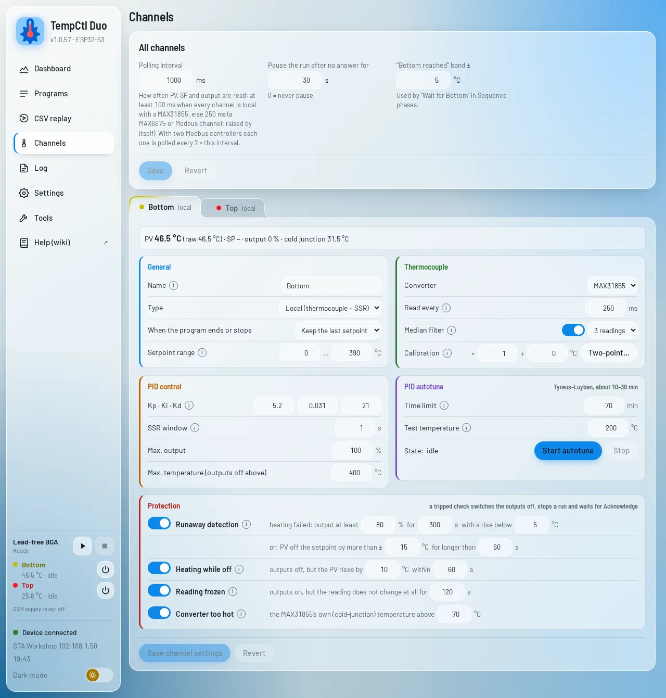
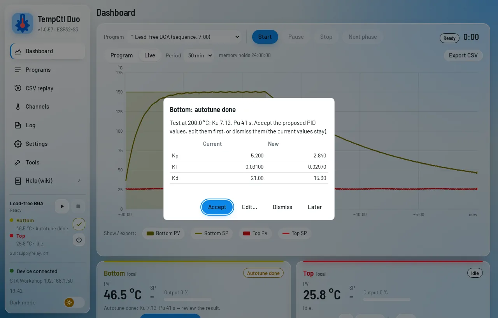
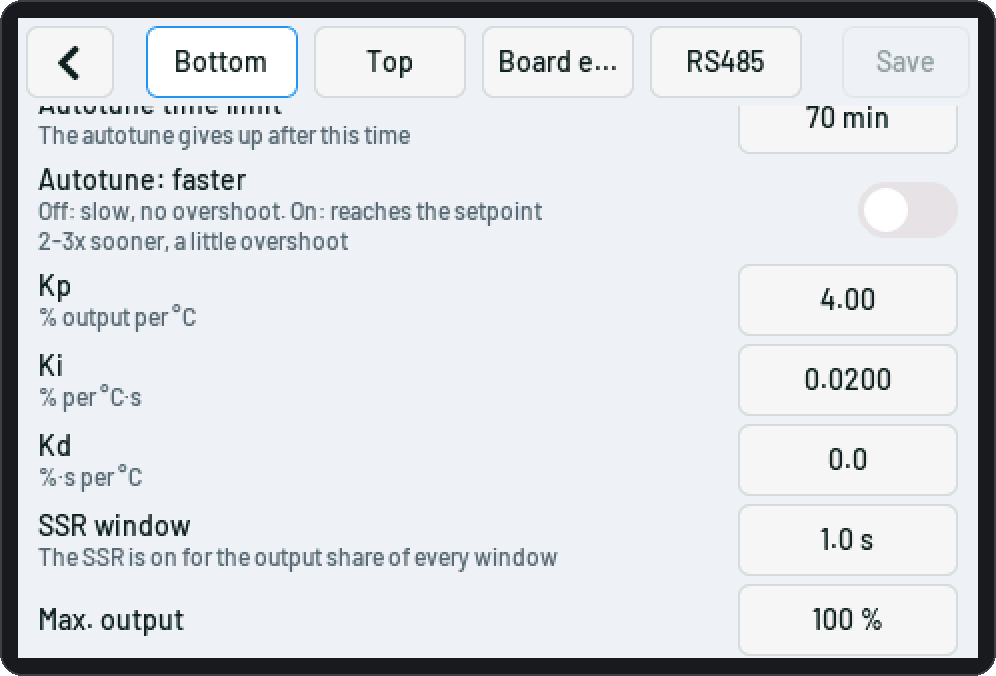
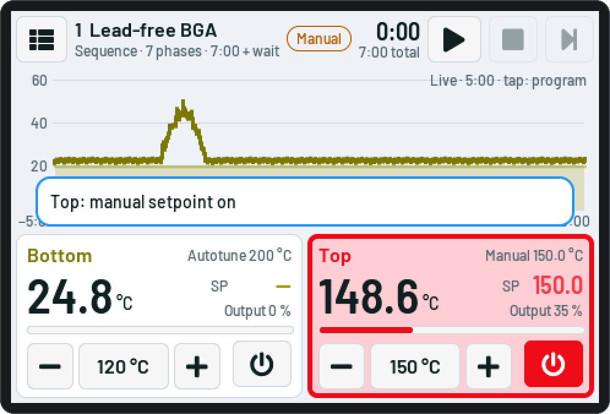
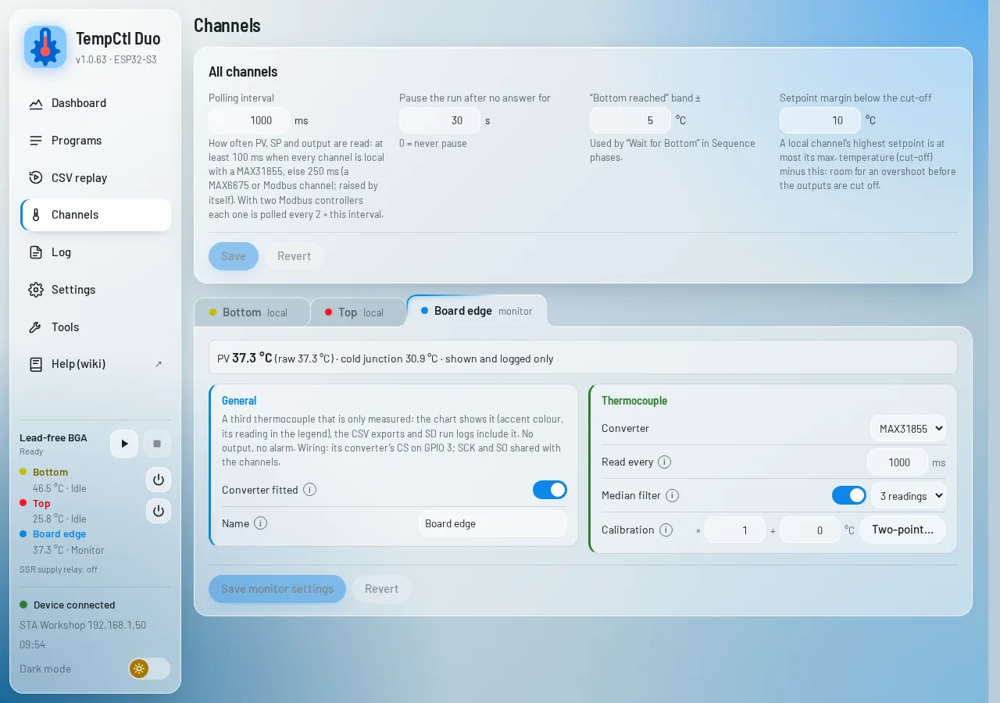

# Channels, PID and autotune

The device has two channels, **bottom** and **top**. Each one is **local**, **Modbus** (beta) or **off**. Set
them on the web page's *Channels* page or on the touch screen (*Menu › Channels*).

<picture><source media="(prefers-color-scheme: dark)" srcset="img/web/channels-local-dark.webp"></picture>

## Settings of every channel

| Setting | |
|---|---|
| Name | up to 16 characters, shown everywhere (default Bottom / Top) |
| Type | *Local (thermocouple + SSR)*, *Modbus controller (beta)*, *Off* |
| When the program ends or stops | keep the last setpoint, go to an end setpoint, outputs off |
| Lowest / highest setpoint | programs, manual setpoints and run edits stay inside; a local channel's highest setpoint is at most its max. temperature minus the *setpoint margin below the cut-off* (all channels, default 10 °C) |

The *All channels* tile holds the **polling interval** (how often PV, setpoint and output are taken over for
the control, the displays and the logs; default 1 s), the **link-loss pause** (Modbus) and the **"bottom
reached" band** (for "wait for the bottom", default ±5 °C).

The shortest polling interval depends on the channels: **100 ms** when every channel in use is local with a
MAX31855, **250 ms** as soon as one is a MAX6675 (it converts in up to 220 ms) or a Modbus controller (bus
time). Switching a channel to one of those raises a shorter interval to 250 ms by itself (the page, the touch
screen and the serial console say so). The web page itself refreshes at most every 250 ms.

## Local channels

A thermocouple converter for the temperature and an SSR for the heater; the ESP32 does the control.

### Thermocouple

| Setting | Default | |
|---|---|---|
| Converter | MAX31855 | or MAX6675 (from 250 ms read interval) |
| Read every | 250 ms | 100 … 1000 ms |
| Median filter | on, 3 readings | 3 / 5 / 7 / 9: removes single spikes (noise from the heater wiring) |
| Calibration | gain 1, offset 0 | true = raw × gain + offset; the web page has a **two-point helper**: enter two reference temperatures and the readings at them |

The PID, the protections and the autotune all use the **filtered, calibrated** value. The live chart and the
web page's raw curve show every reading.

### PID and SSR

| Setting | |
|---|---|
| Kp, Ki, Kd | in % / °C, % / (°C·s), %·s / °C; best found by the autotune |
| SSR window | 1 s: the output (0 … 100 %) is the on-time within each window (zero-cross SSRs switch at the next mains zero) |
| Max. output | limits the heater power, % |
| Max. temperature (outputs off above) | a hard cut-off: above it the outputs go off and the channel faults |

### PID autotune

The autotune measures the heater and proposes PID values:

1. Choose a **test temperature** near your working temperature (50 °C … max. temperature − 20 °C), not during
   a run. Start it on the touch screen (*Channels › PID*), the web *Channels* page or with
   `tune b start temp=200` over serial.
2. The heater is switched up and down around the test temperature (relay method) until the oscillation is
   steady: about 2 settling cycles and 5 measured ones. It takes 10–40 minutes depending on the heater; the
   time limit is *Autotune time limit* (default 70 min). The touch tile and the web card show the progress.
3. When it is done the web page opens a dialog with the **current and the new values**: *Accept* (saved),
   *Edit…* (change them first), *Dismiss* or *Later*. Touch: *Take over* or *Discard* in the channel's PID part.

**Result: slow or faster** (switch in the autotune section; touch: *Autotune result: faster*; serial
`set b.local.tuneFast=on`). Chosen before the start, greyed out while the autotune runs:

| | Rule | Behaviour |
|---|---|---|
| **Slow, no overshoot** (default) | Tyreus–Luyben: Kp = Ku / 2.2, Ti = 2.2 Pu, Td = Pu / 6.3 | no overshoot, but the last few degrees to the setpoint can take minutes |
| **Faster** | the same Kp and Td, Ti = 0.7 Pu | the integral part is three times stronger: the setpoint is reached about 2–3 times sooner, with a little overshoot (a few °C from cold) |

If a channel still overshoots, lower Kp a little; if it is slow to reach the setpoint, raise Ki a little.

<picture><source media="(prefers-color-scheme: dark)" srcset="img/web/dashboard-autotune-dark.webp"></picture>

| | |
|---|---|
| <picture><source media="(prefers-color-scheme: dark)" srcset="img/touch/27-chan-pid-dark.png"></picture> | <picture><source media="(prefers-color-scheme: dark)" srcset="img/touch/01b-tune-toast-dark.png"></picture> |

### Protections

Each local channel has the runaway checks, *heating while off*, *reading frozen* and *converter too hot*
([Safety](Safety.md)). Leave them on.

## Monitor channel (S3)

A third thermocouple that is only **measured**: no output, no setpoint, no fault and no alarm. Fit a third
MAX31855 (or MAX6675) on the shared SCK / SO with its CS on **GPIO 3**
([Hardware: ESP32-S3](Hardware-S3.md#thermocouples)) and switch it on in its own tab, the third one on
*Channels* (accent colour; touch screen: *Monitor*). Settings: on / off, name, converter, read interval
(default 1 s), median filter and calibration (with *Two-point…* on the web page).

Where it shows: the Dashboard chart draws it as a line in the accent colour with its name and current reading in
the legend (no channel card); the touch screen shows the reading at the bottom right of the chart. The CSV
exports (`monitor_pv`, `monitor_min`, `monitor_max`), the last run's CSV and the SD run logs (`monitor_pv`)
include it; the serial `status` shows it as `mon`. The CYD has no free pin for it.

<picture><source media="(prefers-color-scheme: dark)" srcset="img/web/channels-monitor-dark.webp"></picture>

## Modbus channels (beta)

A Modbus channel leaves the control to an RS485 controller (e.g. PMA KS 40-1 / 41-1 / 42-1); the ESP32 writes
its setpoints and reads PV, setpoint and output. Settings: slave address, controller type (PMA or generic,
with its register map), setpoint ramps, front panel lock, the RS485 bus. See
[Modbus controllers](Modbus.md).

## Which channel is which

The **bottom** channel is the large preheater under the board, the **top** channel the IR or hot-air head
above it. "Wait for the bottom" and the Both phase of a Sequence rely on this order. The names are free: they
appear on every screen and in the logs.
