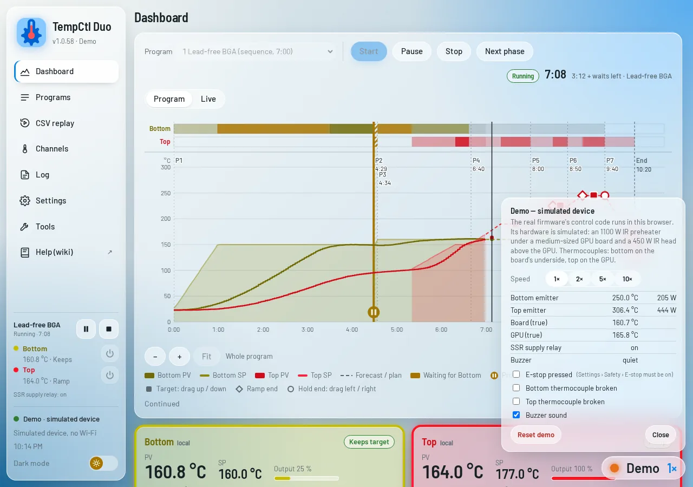

# Browser demo

Try the web page without any hardware: **<https://justr0st.github.io/TempCtl-Duo/demo/>** (any current
browser, also on a phone). The connect screen of the release page and the desktop app has a *Try the demo*
card that opens it.

The demo is the normal web page connected to a **simulated device**. The device is the real firmware: its
control code (programs, run engine, PID and autotune, protections, settings, event log, the web API) is built
for the browser (WebAssembly) and runs in the page. Only the hardware around it is simulated.

<picture><source media="(prefers-color-scheme: dark)" srcset="img/web/demo-dark.webp"></picture>

## The simulated rework station

| Part | In the simulation |
|---|---|
| Bottom heater | 1100 W IR preheater under the board, on the *Bottom* channel (local, MAX31855, SSR) |
| Top heater | 450 W IR head above the GPU, on the *Top* channel (local, MAX31855, SSR) |
| Board | a medium-sized graphics card PCB; the bottom thermocouple sits on its underside next to the GPU |
| GPU | the chip under the top head; the top thermocouple sits on it |
| Board edge | a third thermocouple at the board's edge (about half of its rise): the [monitor channel](Channels.md#monitor-channel-s3), measured only (on from the start) |
| Wiring | SSR supply relay, E-stop input, buzzer, as on the [ESP32-S3 board](Hardware-S3.md); no RS485, display or SD card |

The heaters need time: the emitters warm up first, the board follows at up to about 1 °C/s, and everything
keeps heating for a moment after the outputs go off — as on a real station. The PID values come from an
autotune of the simulated heaters; run your own autotune on the *Channels* page to see how it works.

## What you can do

Everything the web page does with a real device: start, pause and stop programs, *Continue* after an
"Action required", edit programs and run edits, manual setpoints, autotune, channel and safety settings,
accent colour and dark mode, the event log and CSV export. What needs other hardware is not there: Wi-Fi,
firmware updates, the SD card (run logs, backups), Modbus controllers, the touch screen.

## The demo panel

The **Demo** button at the bottom right opens a small panel:

- **Speed** 1×, 2×, 5×, 10×: the simulation (and the device's clock) runs faster, so a 10-minute profile
  takes one minute at 10×.
- What the hardware does: emitter temperatures and power, the true board and GPU temperatures, the SSR supply
  relay, the buzzer.
- **Faults** to try the protections: *E-stop pressed* (switch on *Settings › Safety › E-stop input* first),
  *Bottom / Top thermocouple broken*. *Buzzer sound* plays the alarm in the browser.
- **Reset demo**: settings, programs and the event log back to the first start.

The demo keeps its settings, programs and log in this browser (local storage). Closing or reloading the page is
like switching the device off and on: a program that was running is offered to *Resume* (see
[Programs and runs](Programs.md)), and the heaters have cooled down for the time the page was closed.
