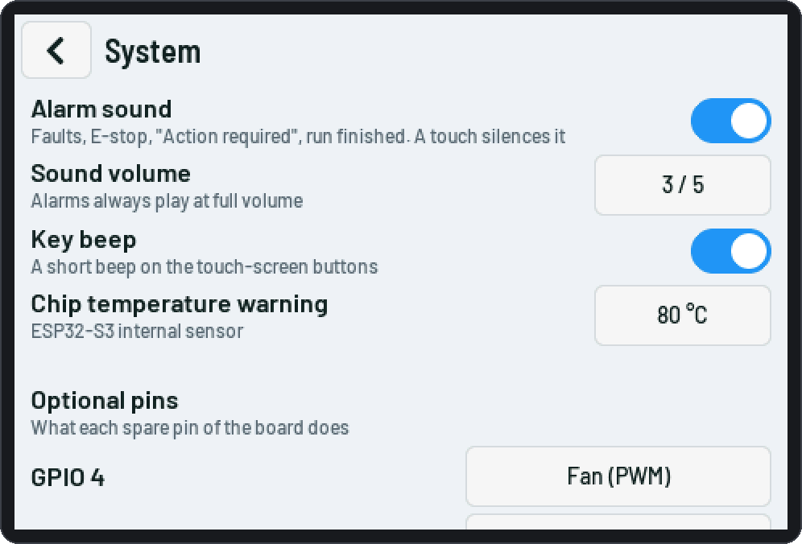
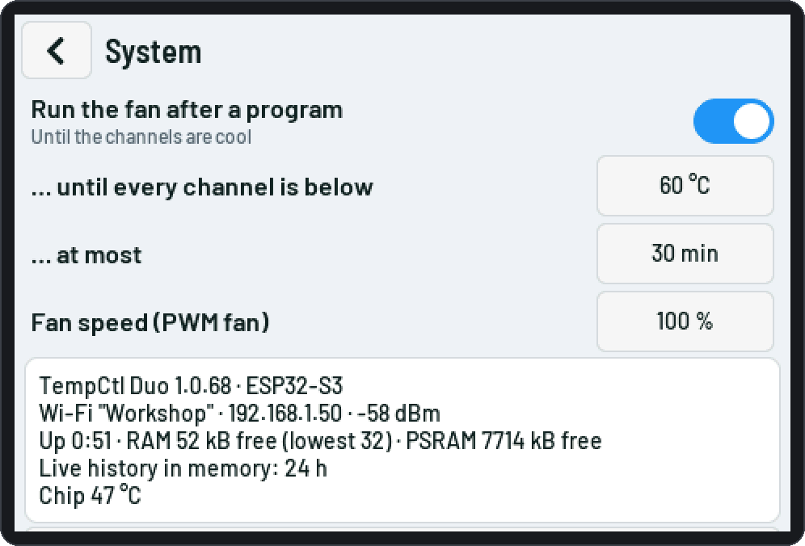

# ESP32-S3 board

The main target (PlatformIO env `s3`): an **ESP32-S3-DevKitC-1 v1.0 N16R8** with a **4.0" SPI display**
(MSP4031: ST7796S 480×320, FT6336U capacitive touch, micro-SD slot). All modules are connected with cables;
the pins are in `src/board_s3.h`. The complete schematic: **[TempCtl-Duo-S3.pdf](../../hardware/s3-schematic/TempCtl-Duo-S3.pdf)**
(A3; KiCad project in `hardware/s3-schematic/`).

The DevKit has two pin headers: **J1** (left) and **J3** (right), top view with the USB ports at the bottom.
Its two USB ports:

| Port | Use |
|---|---|
| **UART** | flashing and the log output |
| **USB** | the serial console and the desktop app's USB link (opening it never resets the board) |

## Connect only what you need

You do not have to wire every part. The software adapts; set what is missing to *Off* so the device does not
complain.

- **A channel you do not use** (thermocouple converter and SSR): leave both out and set the channel's type to
  *Off* (*Channels*, or touch *Menu › Channels*). One channel alone is enough; a program can use just one
  channel. A channel that is still *Local* without a converter shows *no reading: no thermocouple converter*
  and gives a sensor fault as soon as its output is switched on. A program that uses an *Off* channel
  is refused.
- **Modbus / RS485:** the RS485 module is only needed for a *Modbus* channel. With both channels *Local* or
  *Off*, leave it out.
- **Monitor channel** (third converter): optional, off by default.
- **SSR supply relay, E-stop, buzzer, fan** (GPIO 4, 5, 6): all optional. Set an optional pin you do not use
  to *Not used* (*Settings › Safety › Optional pins*); the relay, E-stop and sound settings then disappear.
- Wire any part you do use completely. The E-stop and the relay are safety parts: leaving them out
  means you are without that protection ([Safety](Safety.md)).

## Display and touch

- VCC 5 V is recommended (the backlight takes about 100 mA); the module's logic runs at 3.3 V.
- Keep the SPI wires short. **80 MHz** SPI (setting *Display SPI clock*) needs short, clean wires on GPIO 10–13,
  the SPI bus's IO-MUX pins; with longer wires stay at 40 MHz ([Troubleshooting](Troubleshooting.md)).
- If the colours look inverted, set `LCD_INVERT 1` in `src/board_s3.h`; if touches land in the wrong place,
  change `TOUCH_SWAP_XY` / `TOUCH_INVERT_X` / `TOUCH_INVERT_Y` there.
- The display's micro-SD slot (FAT32 card) holds the run logs, the backups and a `firmware.bin` for an update.

## Thermocouples

- MAX6675 modules fit the same way (choose the converter on the *Channels* page).
- The third converter is optional: the [monitor channel](Channels.md#monitor-channel-s3), measured and logged
  only (CS on GPIO 3, J1-13).
- Use thermocouple wire all the way to the converter; screened cable with the screen to GND at one end
  helps against noise from the heaters.

## SSRs and the SSR supply relay

- Each SSR input is switched by an NPN transistor (1 kΩ base resistor, 10 kΩ base to GND). The pull-down keeps
  the SSR off while the ESP32 resets or is being flashed.
- The **SSR supply relay** is an active-high DC solid-state relay (input 3–32 V DC, at most 20 mA at 3.3 V;
  output at least 0.5 A DC) in the +5 V of both SSR inputs, driven directly by GPIO4. It is on only while a
  local channel heats (or autotune runs) and goes off at once on any fault or the E-stop. It covers a stuck SSR
  input or driver transistor; an SSR whose output is shorted keeps heating — that needs the contactor and the
  independent limiter ([Safety](Safety.md)).
- Setting *Settings › Safety › SSR supply relay* (`safety.relay`, default on): switch it off only when no
  relay is fitted and the SSR "+" inputs get 5 V directly.

## E-stop and alarm sound

The E-stop input is off by default: wire a normally-closed contact, then switch *Settings › Safety › E-stop
input* on. The page shows the contact state live, so you can test it before switching it on.

## Optional pins and the cooling fan

GPIO **4**, **5** and **6** are *optional pins*: each one gets its function from *Settings › Safety › Optional
pins* (touch *Menu › System*, serial `io.fn0` / `io.fn1` / `io.fn2`):

| Function | Pin is | Used for |
|---|---|---|
| Not used | input with pull-down | — |
| SSR supply relay | output, high = on | [the relay above](#ssrs-and-the-ssr-supply-relay) |
| E-stop input | input, pull-up | NC contact to GND |
| Buzzer | output, tone | the alarm buzzer |
| Fan (on / off) | output, high = on | a cooling fan, switched on and off |
| Fan (PWM) | output, 25 kHz PWM | a 4-wire fan's control wire |
| Fan speed input | input, pull-up, counts edges | the fan's tach wire |

The **default wiring is unchanged**: GPIO4 relay, GPIO5 E-stop, GPIO6 buzzer. A function can be on one pin only.
From power-on until the settings are applied every optional pin is a plain input with a pull-down, so nothing
is driven by accident. A fan needs one output pin (on / off or PWM) and, if you want its speed, a second one for
the tach wire; those pins are then not available for the relay, E-stop or buzzer.

### Cooling fan (optional)

A GPIO is 3.3 V and gives only a few mA: **never connect a fan to the pin directly**.

- **On / off fan:** the pin drives a transistor or MOSFET (active high; a logic-level N-MOSFET or an NPN with a
  1 kΩ base resistor, 10 kΩ to GND) or a relay module that switches the fan's supply. Add a flyback diode for
  a relay coil.
- **PWM fan (4-wire):** the PWM goes to the fan's **control wire** at **25 kHz**, the speed is the duty cycle
  (setting *Fan speed*, 20 … 100 %). Many 4-wire fans pull that wire up to 5 V themselves, so drive it through
  a transistor (open collector to the fan's wire). A transistor **inverts** the signal, and no setting
  inverts it back yet.
- **Speed input (tach):** connect the fan's tach wire (open collector) to the pin, GND common; the pull-up
  is internal. The device counts 2 pulses per turn and shows the speed in rpm (once a second). A fan that
  is on for 5 s below 100 rpm gives a warning.

When the fan runs: while the running phase / step has the *Fan* option ([Programs](Programs.md#fan)), and after
a run until every channel (and the monitor) is below *Fan runs until every channel is below* (60 °C), at most
*at most* (30 min). A new run, manual mode or an autotune that heats ends it at once. There is no manual
fan switch.

<picture><source media="(prefers-color-scheme: dark)" srcset="img/touch/14k-system-sound-pins-dark.png"></picture>
<picture><source media="(prefers-color-scheme: dark)" srcset="img/touch/14l-system-fan-dark.png"></picture>

## RS485 (Modbus channels, beta)

See [Modbus controllers](Modbus.md) for the controller's settings.

## Status LED

The on-board RGB LED (GPIO48) shows the state: **green** idle, **blue** running, **amber blinking** paused /
waiting, **red blinking** fault, **purple** access point mode.

## Pin table

| Function | GPIO | Header | | Function | GPIO | Header |
|---|---|---|---|---|---|---|
| LCD SCK / MOSI / MISO | 12 / 11 / 13 | J1-18 / 17 / 19 | | RS485 TX → DI | 1 | J3-4 |
| LCD CS / D/C / RST | 10 / 9 / 14 | J1-16 / 15 / 20 | | RS485 RX ← RO | 2 | J3-5 |
| Backlight (PWM) | 8 | J1-12 | | RS485 DE + /RE | 42 | J3-6 |
| SD card CS | 18 | J1-11 | | Thermocouple SCK / SO | 41 / 40 | J3-7 / 8 |
| Touch SDA / SCL | 16 / 15 | J1-9 / 8 | | Thermocouple CS bottom / top | 39 / 38 | J3-9 / 10 |
| Touch RST / INT | 17 / 7 | J1-10 / 7 | | SSR bottom / top | 21 / 47 | J3-18 / 17 |
| Optional pin 1 (default: SSR supply relay) | 4 | J1-4 | | Optional pin 2 (default: E-stop, NC to GND) | 5 | J1-5 |
| Optional pin 3 (default: alarm buzzer) | 6 | J1-6 | | Status LED (WS2812) | 48 | on board |
| Thermocouple CS monitor (optional) | 3 | J1-13 | | | | |

Keep free: GPIO35–37 (octal PSRAM), 19 / 20 and 43 / 44 (the USB ports), the strapping pins 0, 45, 46. GPIO 3
is a strapping pin only for the JTAG source when an eFuse selects it (not on these boards): fine as the monitor
converter's CS (held high from the start).

## Reference

- **Schematic of the whole device** (A3): [TempCtl-Duo-S3.pdf](../../hardware/s3-schematic/TempCtl-Duo-S3.pdf) — the KiCad
  project (KiCad 7 … 10) and a PNG are next to it in `hardware/s3-schematic/`; `hardware/gen/` generated it.
- The earlier all-in-one drawing: `claude/wiring/s3-wiring.png`.
