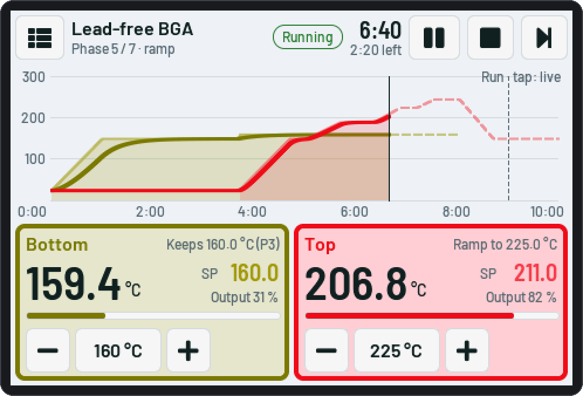

# TempCtl Duo wiki

TempCtl Duo is a two-channel ramp / soak temperature programmer for the **bottom and top heater of a BGA
rework station**: reflow and desolder profiles that drive both heaters together, from a touch screen, a web
page or a USB cable. This wiki follows the newest firmware release: how to build the hardware, wire it, flash
it and use it.

<picture><source media="(prefers-color-scheme: dark)" srcset="img/web/dashboard-run-dark.webp"></picture>

## What it does

- **Two channels**, bottom and top. Each one is **local** (a thermocouple converter and an SSR; the ESP32 does
  the PID control, with autotune), **Modbus RTU** (an RS485 controller such as a PMA KS 40-1 does the PID; beta)
  or **off**.
- **Up to 20 programs** that drive both channels: *Sequence* (phases one after another) or *Timeline* (two
  independent step lists). Ramps, holds, "wait for the bottom", pauses with "Action required", run edits while
  the program runs, resume after a power loss.
- **Manual setpoint** per channel, when no program runs.
- A **touch screen** on the device and a **web page** with the same functions; the same page also works over
  the **USB cable** in the desktop app.
- **Protections** in the firmware: runaway, heating while off, frozen reading, converter too hot, E-stop
  input, an SSR supply relay, alarm sound.
- **Releases** on this site: the firmware updates itself from here (web page on every board, the S3 also by
  itself).

<picture><source media="(prefers-color-scheme: dark)" srcset="img/touch/03-running-dark.png"></picture>

## The parts

Two boards run the same firmware:

| Board | Screen | What it suits |
|---|---|---|
| **ESP32-S3-DevKitC-1 N16R8** + 4.0" SPI display (env `s3`) | 480×320, capacitive touch | the main target: two local channels, RS485, E-stop, SSR supply relay, buzzer, SD card (run logs, backups, updates), online update |
| **ESP32-2432S028R "Cheap Yellow Display"** (envs `cyd-…`) | 320×240, resistive touch | a compact build; few free pins, so three wirings (RS485 + one local channel, two local channels, or both with the RGB LED removed) |

> **Status:** local thermocouple + SSR channels are the tested path, on both boards. Modbus RTU channels are
> built in but have not been tested with a real controller yet (beta).

## Where to start

1. [Getting started](Getting-started.md): parts, flashing, Wi-Fi, the first run.
2. Wiring: [ESP32-S3 board](Hardware-S3.md) or [CYD board](Hardware-CYD.md).
3. Daily use: [Touch screen](Touch-screen.md), [Web page](Web-page.md), [Programs and runs](Programs.md).
4. Before the first real heating: [Channels, PID and autotune](Channels.md) and [Safety and protections](Safety.md).

> **Safety:** a software controller must never be the only protection against overheating. Fit an independent
> over-temperature limiter and a contactor in the heater supply ([Safety](Safety.md)).
