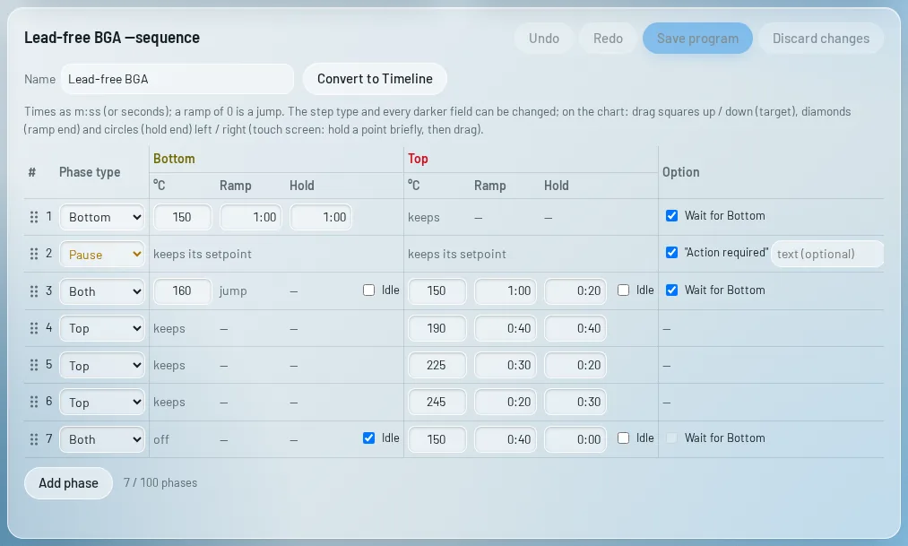
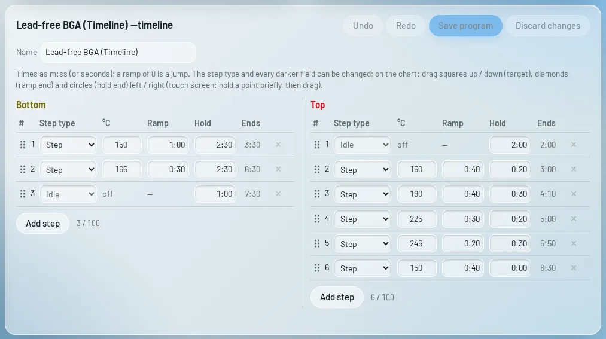
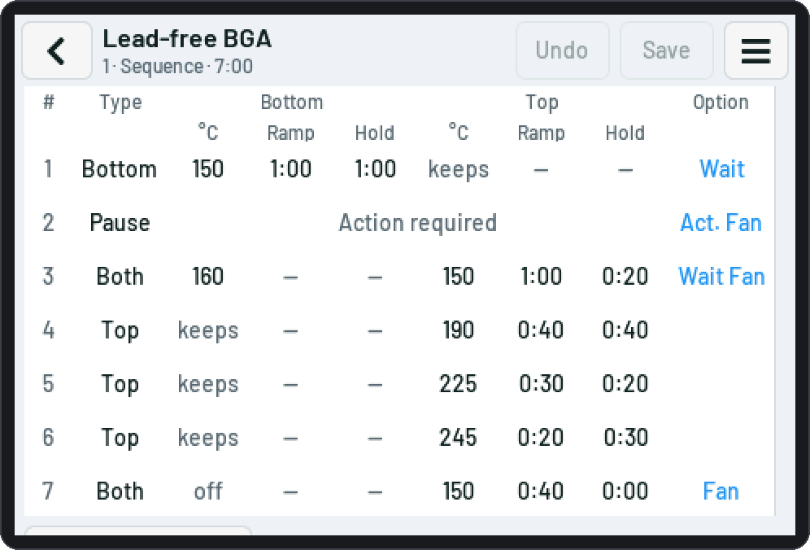
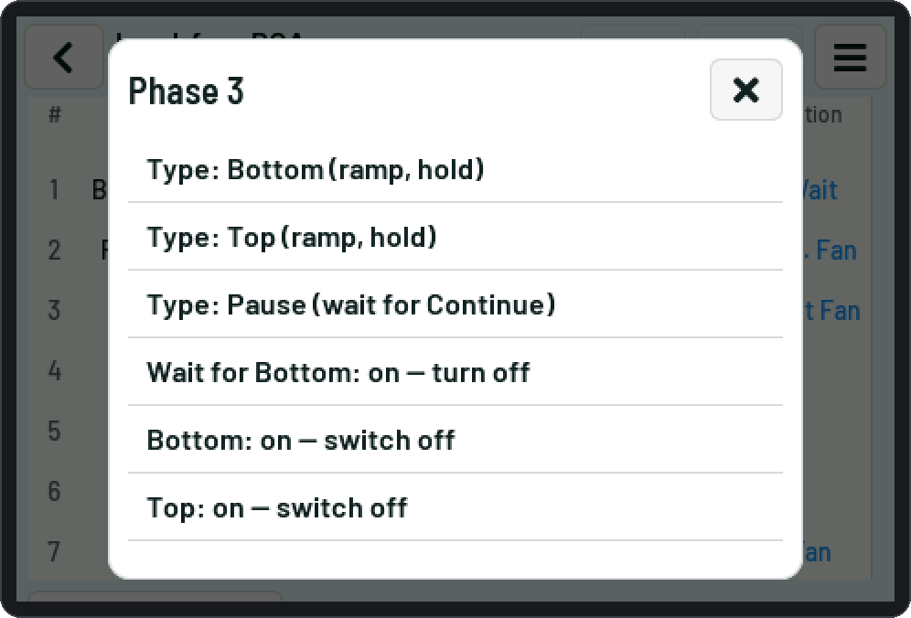
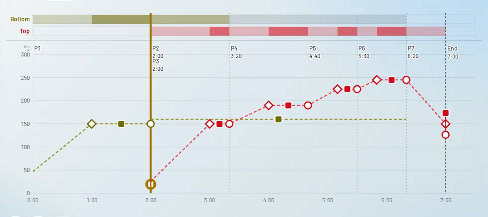
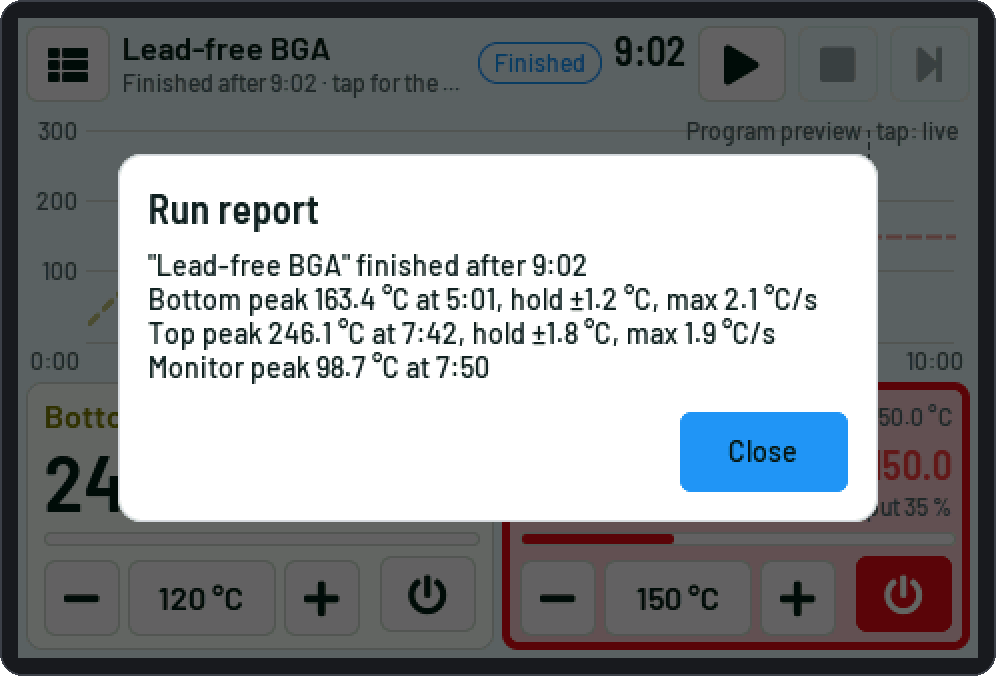
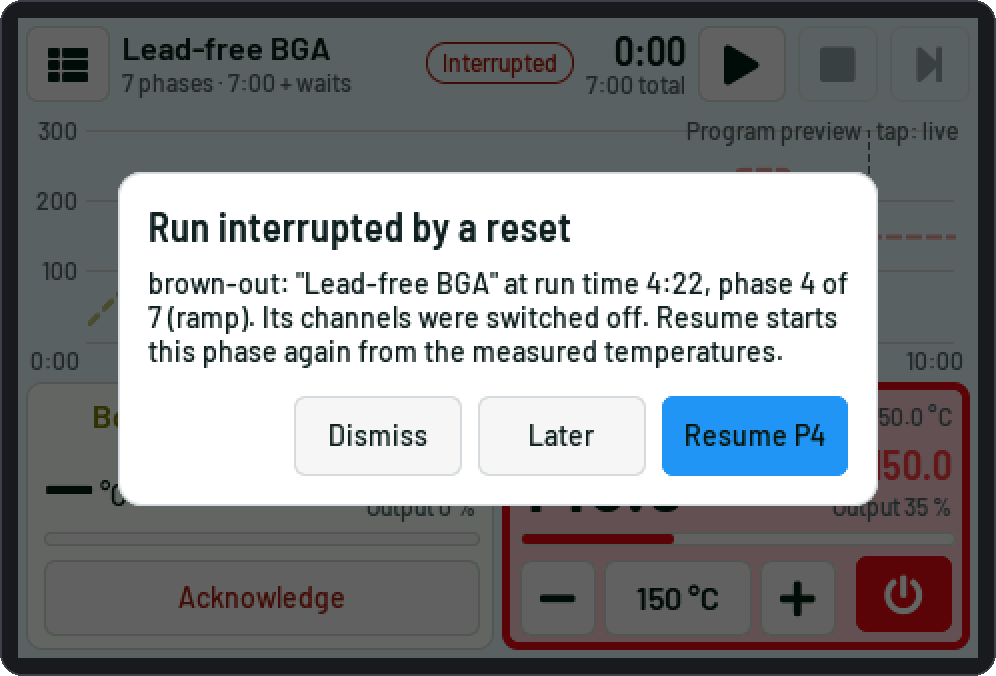
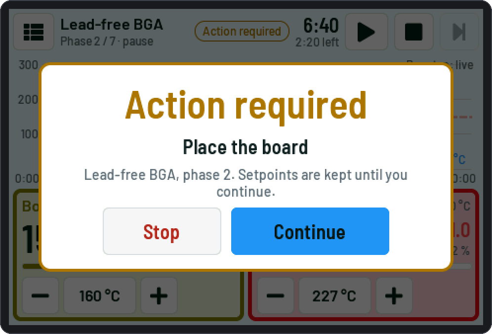

# Programs and runs

One program drives **both channels**. The device stores up to **20 programs** (names up to 31 characters);
on the first start it creates three examples: *Lead-free BGA*, *Leaded BGA* and *Lead-free BGA (Timeline)*.
Times are entered and shown as m:ss (plain seconds are accepted too); a ramp of 0 is a jump.

## Two program types

### Sequence

Phases one after another (up to 100):

| Phase | What it does |
|---|---|
| **Bottom** (`B`) | the bottom ramps to its target, then holds it |
| **Top** (`T`) | the top ramps to its target, then holds it |
| **Both** (`BT`) | the bottom jumps to its target (or goes *Idle* = outputs off), the top ramps and holds. With the **top *Idle*** it is the other way round: the top outputs go off, the bottom ramps and holds. **Both *Idle***: both outputs off for the phase's time (the bottom's *Hold*) |
| **Pause** (`P`) | waits for *Continue*; optionally **"Action required"** with a text up to 40 characters ("Place the board") |

- **Wait for the bottom** (Bottom and Both phases): the hold (Bottom, Both with the top Idle) or the top ramp
  (Both) starts only when the bottom has reached its target within the *"bottom reached" band* (default ±5 °C).
- A channel **keeps its last target** while other phases run.

<picture><source media="(prefers-color-scheme: dark)" srcset="img/web/editor-seq-dark.webp"></picture>

### Timeline

Two independent step lists (up to 100 steps each), started together:

| Step | What it does |
|---|---|
| **Step** | target, ramp time, hold time |
| **Idle** | outputs off for a time |
| **Pause** | the whole run pauses (both channels) until *Continue* |

A channel that finishes earlier keeps its last target until the other one is done.

<picture><source media="(prefers-color-scheme: dark)" srcset="img/web/editor-tl-dark.webp"></picture>

A Sequence can be turned into a Timeline (*Convert to Timeline* on the web page): the same temperatures and
times; "wait for bottom" is dropped. A Timeline can't be turned back.

## Fan

With a cooling fan configured (S3: an optional pin set to *Fan (on / off)* or *Fan (PWM)*,
[Hardware](Hardware-S3.md#optional-pins-and-the-cooling-fan)) every phase and step has a **Fan** option: the fan
runs while that phase / step runs. It is only shown when a fan output exists; a program keeps its Fan marks
otherwise (`"fan": true` in the program file). Touch: the *Option* column of the Sequence editor (*Wait*,
*Action*, *Fan*), the Fan entry of the row menu, a *Fan* mark on a Timeline step; web: the *Fan* checkbox.

After a run the fan can go on until the channels are cool (*Run the fan after a program*, default 60 °C, at most
30 min). A new run, manual mode or an autotune that heats ends it. The fan's state is shown on the main screen
(*Fan*, with the speed when there is a tach input), on the web page (chip *Fan on* by the run state) and in
`status`.

| | |
|---|---|
| <picture><source media="(prefers-color-scheme: dark)" srcset="img/touch/20c-edit-seq-fan-dark.png"></picture> | <picture><source media="(prefers-color-scheme: dark)" srcset="img/touch/21c-rowmenu-fan-dark.png"></picture> |

## Ramps

- The **first ramp** of a channel, and the first ramp after Idle, starts at its **measured** temperature; later
  ramps start at the previous target.
- A channel without phases / steps in the program stays under manual control during the run. The program's
  channels start with their outputs off until they get a target.

## Running a program

Choose the program (touch: tap the header; web: the *Program* list), then **Start**.

| Button | |
|---|---|
| **Pause / Continue** | freezes the program time (ramps stop where they are) |
| **Stop** | ends the run; each channel applies its end action |
| **Next phase** (Sequence) | ramp → hold (setpoint at the target), wait → hold / top ramp, hold → next phase; in a pause: continue |

<picture><source media="(prefers-color-scheme: dark)" srcset="img/web/editor-chart-dark.webp"></picture>

### Changes during a run (run edits)

While a program runs you can change the **running copy** (touch editor, web tables or chart handles, target
buttons on the cards / tiles):

- extend or shorten a hold (not below the time already held; down to "now" ends it), *+ Hold* / *Extend hold*;
- change later ramp times;
- change targets: the current one, later ones, or the target a channel keeps.

Slopes are kept and times adapt. In a Timeline a timing change of one channel shifts the other one through its
holds. After the run the device asks whether to **save the changes** into the program.

### The end

Each channel of the program applies its own **end action**: *keep the last setpoint*, *go to an end setpoint*
or *outputs off*. With "keep" or "end setpoint" the channel goes on in manual mode with that setpoint (its
manual button is on; switch it off when you are done). The alarm plays its three "finished" tones.

### Run report

When a run ends (finished or stopped) the device works out a short **report**, per channel:

- the **highest temperature** and the run time it happened,
- the **largest deviation from the setpoint in the holds** (counted from 5 s into each hold),
- the **steepest rise** over 5 s, in °C/s;

and the highest temperature of the monitor channel, if it is on. A channel that measured nothing is left out.
A run you resumed after a reset reports the part after the resume.

The report is written to the event log (and so into the SD run log as event rows) and stays until the device
restarts or another run starts. Touch: tap the **Finished / Stopped** badge. Web: the **Last run** block on the
Dashboard. Serial: `report`. `/api/live` has it as `report` ([Web API](Web-API.md)).

<picture><source media="(prefers-color-scheme: dark)" srcset="img/touch/31b-run-report-dark.png"></picture>

## Manual setpoint

Outside a run (and for a channel the program doesn't use) each channel has a **manual setpoint** with an
on / off switch: the touch tile, the web card or sidebar, the serial command `manual`.

- **On:** local channel: the PID heats to the setpoint; Modbus: the controller's outputs on, the setpoint
  written.
- **Off:** local: SSR off; Modbus: outputs off.
- Manual mode is always off after a restart (the value is remembered). An optional **manual mode timeout**
  switches it off after a time without any touch, web or serial action ([Safety](Safety.md)).

## Faults and lost channels

- A **fault** on any channel of the program (no reading, runaway, over temperature …) stops the run, switches
  that channel's outputs off and waits for *Acknowledge* ([Safety](Safety.md)).
- A Modbus channel that doesn't answer for 30 s (*link-loss pause*, Channels page) pauses the program.
- **Start warning:** a channel that is already within 10 °C of (or above) its first target when the program
  starts gets a warning message; the run starts anyway.

## Run interrupted by a reset

After a power loss, brown-out, watchdog or crash during a run the device starts with the program's channels
**off** and shows **"Run interrupted by a reset"** with the reason, program, phase / steps and run time — on the
touch screen, the web page and the serial console. It never resumes by itself:

- **Resume** — Sequence: the interrupted phase from its beginning (ramps from the measured temperatures;
  channels the phase doesn't start get their kept target at once). Timeline: on at the interrupted run time,
  ramps from the measured temperatures in the time they had left, holds with their remaining time.
- **Later** (touch) — closes the message; the red "Interrupted" badge opens it again.
- **Dismiss** — the outputs stay off.

Starting another program also ends the offer. The position is kept exactly across resets (RTC memory) and,
for a power loss, saved at every phase / step change and every minute.

| | |
|---|---|
| <picture><source media="(prefers-color-scheme: dark)" srcset="img/touch/09-interrupted-dark.png"></picture> | <picture><source media="(prefers-color-scheme: dark)" srcset="img/touch/06-action-dark.png"></picture> |

## Run logs

On the S3 every run is logged to the SD card (`runs/` folder, one CSV per run, a row every second plus the
events). The web *Log* page lists them; *Replay* shows a log as a chart ([Web page](Web-page.md#csv-replay)).

## Program files

Programs are JSON files (`/duo/prog0.json` … `prog19.json` on the device). The web *Programs* page exports and
imports single programs; *Tools › Backup* saves all of them in one file.
