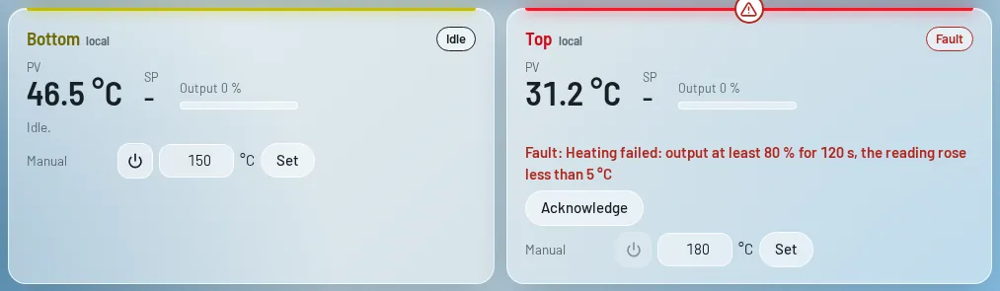
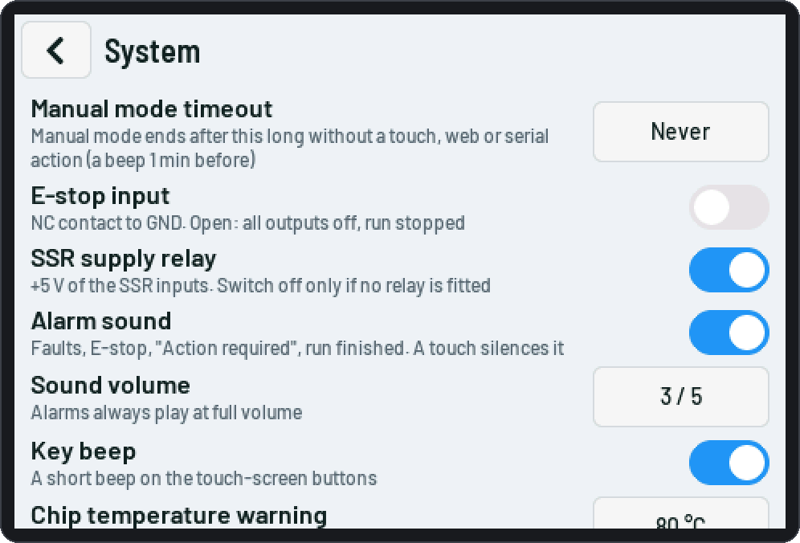

# Safety and protections

> **Safety:** a software controller must never be the only protection against overheating. Fit an
> **independent over-temperature limiter** (for a PMA controller: the TB 40-1 its manual recommends) that
> switches a **contactor** in the heater supply. An SSR can fail shorted; then only the contactor stops the
> heater. Use the controllers' own limit alarms and setpoint limits as well.

Wire the mains side (L – fuse – SSR – heater – N) to the rules where you live, with proper enclosures, strain
relief and earth. The wiring diagrams show only the low-voltage side.

## Per channel

Set on the web *Channels* page › *Protection*, the touch *Menu › Channels*, or over serial
(`b.local.runaway.*`, `t.modbus.runaway.*` …). A tripped check switches the channel's outputs off (local: also
the SSR supply relay), stops a run and waits for **Acknowledge** (touch tile, web card, `ack b`). Acknowledge
is refused while the cause is still there; the outputs stay off until you switch them on again.

| Check | Default | Trips when |
|---|---|---|
| **Runaway: heating failed** | on | output ≥ 80 % for 300 s (top: 120 s) with less than 5 °C rise — sensor not on the heater, heater or SSR broken |
| **Runaway: left the setpoint band** | on | more than ±15 °C away for 60 s after the setpoint was reached |
| **Heating while off** | on, 10 °C in 60 s | the outputs are off but the temperature rises — a stuck SSR or controller; from 2 min after off, not while the other channel heats (its heat reaches the sensor). Modbus: only after an "outputs off" was written |
| **Reading frozen** | on, 120 s | outputs on, the unfiltered reading did not change at all — a stuck converter or controller value |
| **Converter too hot** (local, MAX31855) | on, 70 °C | the converter's own (cold-junction) temperature; outputs can't be switched on above it |
| **Over temperature** (local) | always | above *Max. temperature (outputs off above)* |
| **Sensor fault** | always | bad readings (no reading: open thermocouple, short, converter missing; or a jump of more than *Largest change per reading*, 25 °C) for *Sensor fault after* (3 s) while the outputs are on. The first bad readings are held back and the output stays; a valid reading that lasts is the new level ([Channels](Channels.md#thermocouple)) |
| **Control task stopped** | always | a heating local channel got no report from the control task for 10 s (the task hangs or is blocked): outputs off. Before, such a channel kept its last setpoint |

Modbus channels get the same runaway checks with the controller's output; a fault switches the controller's
outputs off.

<picture><source media="(prefers-color-scheme: dark)" srcset="img/web/dashboard-fault-dark.webp"></picture>

## For the whole device

Set on the web *Settings › Safety*, the touch *Menu › System* or with `set safety.…`:

| Setting | Default | |
|---|---|---|
| **Manual mode timeout** | off, 30 min | manual mode ends after this long without a touch, web action or serial command; a message and beeps 1 min before |
| **E-stop input** (S3, optional pin: GPIO5 by default) | off | NC contact to GND. Open contact or broken wire: SSRs and the relay off at once, run stopped, manual and autotune off, Modbus outputs off; nothing can be switched on while it is open |
| **SSR supply relay** (S3, optional pin: GPIO4 by default) | on | on while a local channel heats or autotune runs; off when none does and at once on any local fault or E-stop. Off only when no relay is fitted |
| **Alarm sound** (S3 optional pin: GPIO6 by default, CYD speaker P4) | on | fault / E-stop: 3 long beeps every 3 s; "Action required" and the timeout warning: 2 short beeps every 10 s; run finished: three rising tones; each has its own pitch. Any touch, web action or serial command silences the current alarm. *Test beep* on the web page (it plays even with the sound off) |
| **Sound volume** (`safety.volume`) | 3 | 1 (quietest) … 5. **Alarms (faults, E-stop) always play at full volume** |
| **Key beep** (`safety.keyBeep`) | on | a short beep on a completed tap on the touch screen; a refused action or error message plays a low tone, a successful save a rising one. It never interrupts an alarm |
| **Chip temperature warning** (S3) | on, 80 °C | the ESP32-S3's own temperature, read every 30 s; a warning event above the limit |

**Optional pins (S3).** GPIO 4, 5 and 6 each get a function in *Settings › Safety › Optional pins* (touch: *Menu
› System*, serial `io.fn0 … io.fn2`): *Not used*, *SSR supply relay*, *E-stop input*, *Buzzer*, *Fan (on / off)*,
*Fan (PWM)* or *Fan speed input*. A function can be on one pin only; the device refuses anything else with a
message. The defaults are the old wiring (GPIO4 relay, GPIO5 E-stop, GPIO6 buzzer). **"E-stop", "relay" and
"sound" now mean that a pin has that function**: without such a pin the setting is not shown and the check is
not wired. From the start of the device until the settings are applied every optional pin is an input with a
pull-down: nothing is driven, so an SSR supply relay stays off. The CYD has no optional pins (its buzzer is the
speaker). For the fan see [Hardware: ESP32-S3](Hardware-S3.md#cooling-fan-optional).

<picture><source media="(prefers-color-scheme: dark)" srcset="img/touch/14d-system-safety-dark.png"></picture>

## Built into the firmware

- The SSR pins are driven low from the first line of the start-up code; the hardware's 10 kΩ pull-downs keep
  them off during a reset and while flashing.
- A local channel's SSR goes off when the control task stops refreshing it (1.5 s). The control task also
  reports to the local task on every pass (a heartbeat): 10 s without a report is the fault *control task
  stopped* (above).
- Bad thermocouple readings are held back, not acted on ([Channels](Channels.md#thermocouple)); the cut-off
  is checked on them as well.
- A watchdog restarts a hanging device; a run is then **never resumed automatically**
  ([Programs](Programs.md#run-interrupted-by-a-reset)).
- Manual mode is always off after a restart.
- A new firmware runs "on probation" and the previous one comes back if it does not start correctly
  ([Updates](Updates-and-backups.md)).

## Check before the first real heating

1. The independent limiter cuts the heater power at its set temperature (test it, e.g. by lowering its limit).
2. S3: E-stop on and tested: pressing it switches everything off, the event log says so.
3. Each thermocouple belongs to its heater: heat one by hand, the right reading rises.
4. A short manual run of each heater: the temperature settles without big overshoot (otherwise run the
   autotune).
