# Touch screen

The device's own screen does everything the web page does: run programs, edit them, set up channels, network,
display and safety. The pictures show the S3 (480×320); the CYD has the same screens in a compact form
([below](#cyd-320240)).

**Touch rule:** a press counts where it is released. Slide your finger off a button (more than about 10 px)
and nothing happens — a safe way to cancel a press.

## Main screen

<picture><source media="(prefers-color-scheme: dark)" srcset="img/touch/03-running-dark.png"></picture>

- **Header**: the program (tap it to choose the program for the next run), the phase or steps, the state
  (Idle, Running, Paused …), run time and remaining time, and the run buttons: **Start / Pause / Continue**,
  **Stop**, **Next phase**.
- **Chart** of both channels: temperatures (solid), setpoints, the rest of the program (dashed). Tap it to
  switch between the **program view** and the **live view** (the last minutes; period under *Display*).
- **One tile per channel**: the temperature (PV), the setpoint (SP), the output bar, what the channel does
  (Ramp to 225 °C, Keeps 160 °C, Idle …). While its outputs are on, the tile gets a border and a tint in the
  channel colour.
- **Target stepper** `− value +`: during a run it changes the current (or kept) target of that channel;
  outside a run it is the **manual setpoint**. Hold + / − to repeat; tap the value for the number pad.

<picture><source media="(prefers-color-scheme: dark)" srcset="img/touch/01-idle-dark.png">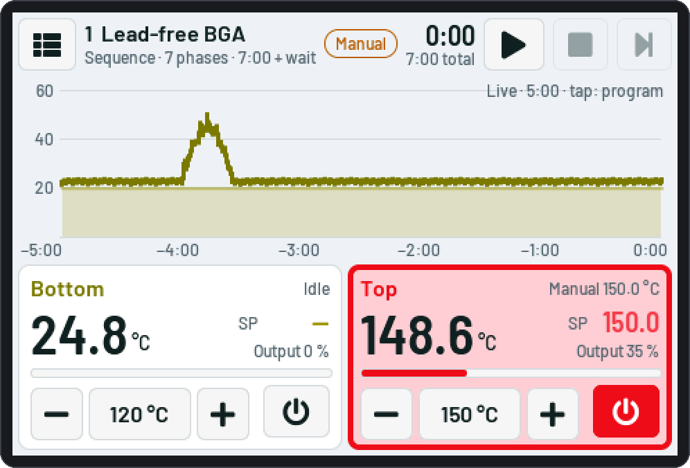</picture>

Outside a run each tile has the **manual on / off** button (filled in the channel colour while on): the
channel heats to the manual setpoint until you switch it off ([Programs](Programs.md#manual-setpoint)).

<picture><source media="(prefers-color-scheme: dark)" srcset="img/touch/05-numpad-dark.png">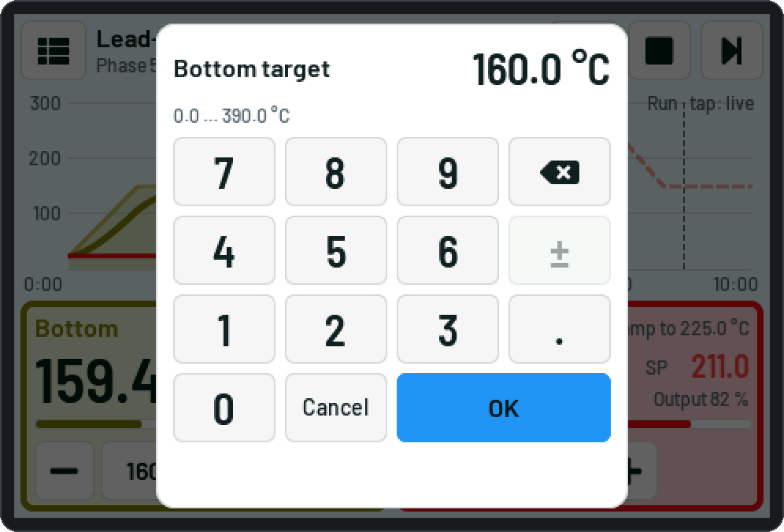</picture>

### Messages and overlays

| Picture | When |
|---|---|
| <picture><source media="(prefers-color-scheme: dark)" srcset="img/touch/06-action-dark.png">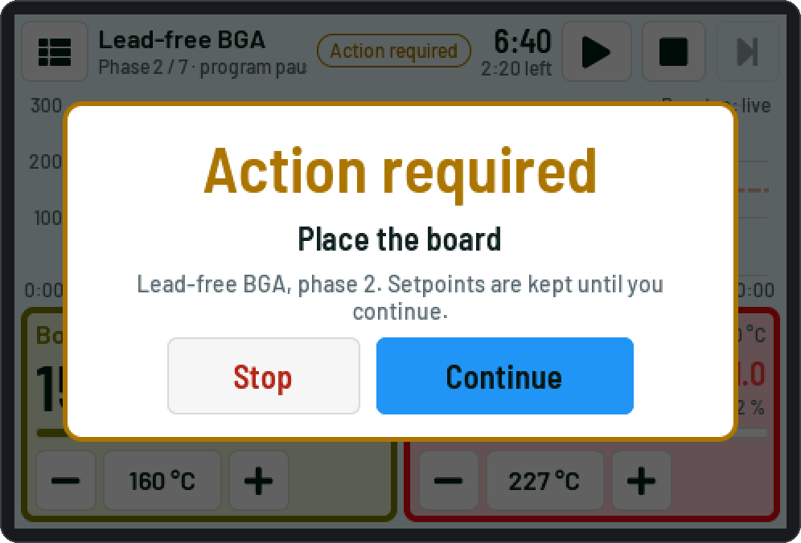</picture> | **Action required**: a Pause phase asks you to do something (place the board, lift the part …). *Continue* goes on, *Stop* ends the run. The alarm sounds two short beeps every 10 s until then. |
| <picture><source media="(prefers-color-scheme: dark)" srcset="img/touch/09-interrupted-dark.png">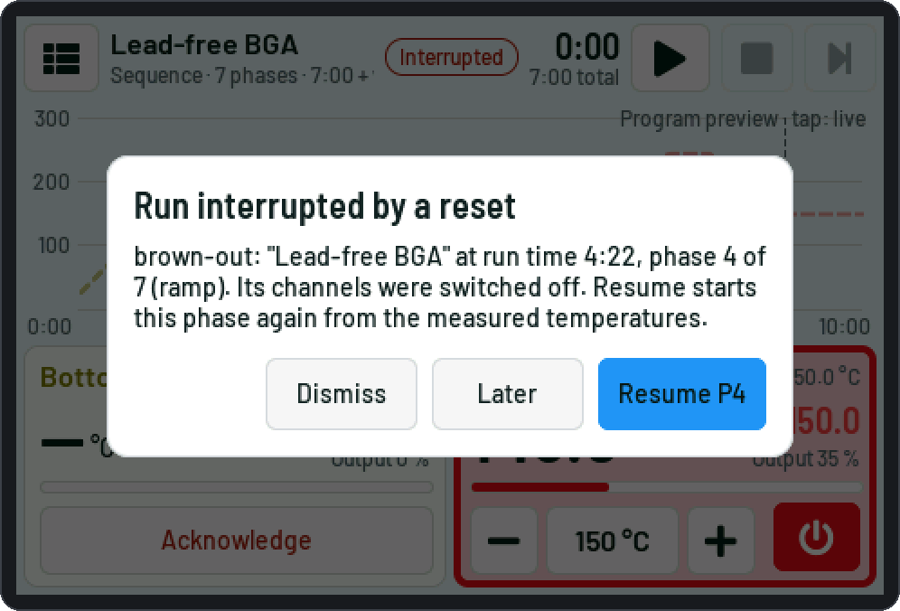</picture> | **Run interrupted by a reset** (power loss, watchdog, crash): *Resume*, *Later* (the red "Interrupted" badge opens it again) or *Dismiss*. The device never resumes by itself. |
| <picture><source media="(prefers-color-scheme: dark)" srcset="img/touch/10-fault-dark.png">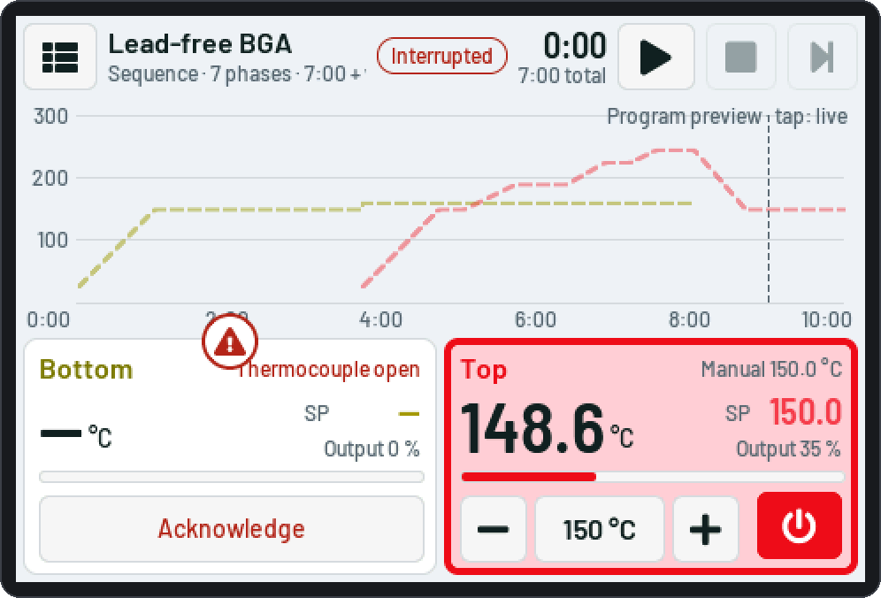</picture> | **Fault** on a channel (no reading, runaway, over temperature …): outputs off, run stopped, the tile shows the reason and *Acknowledge*. |
| <picture><source media="(prefers-color-scheme: dark)" srcset="img/touch/01b-tune-toast-dark.png"></picture> | Short messages appear at the bottom; an autotune shows its progress in the tile. |

After a run with changes (run edits), the screen asks **"Save the run's changes?"** into the program.

## Menu

<picture><source media="(prefers-color-scheme: dark)" srcset="img/touch/11-menu-dark.png">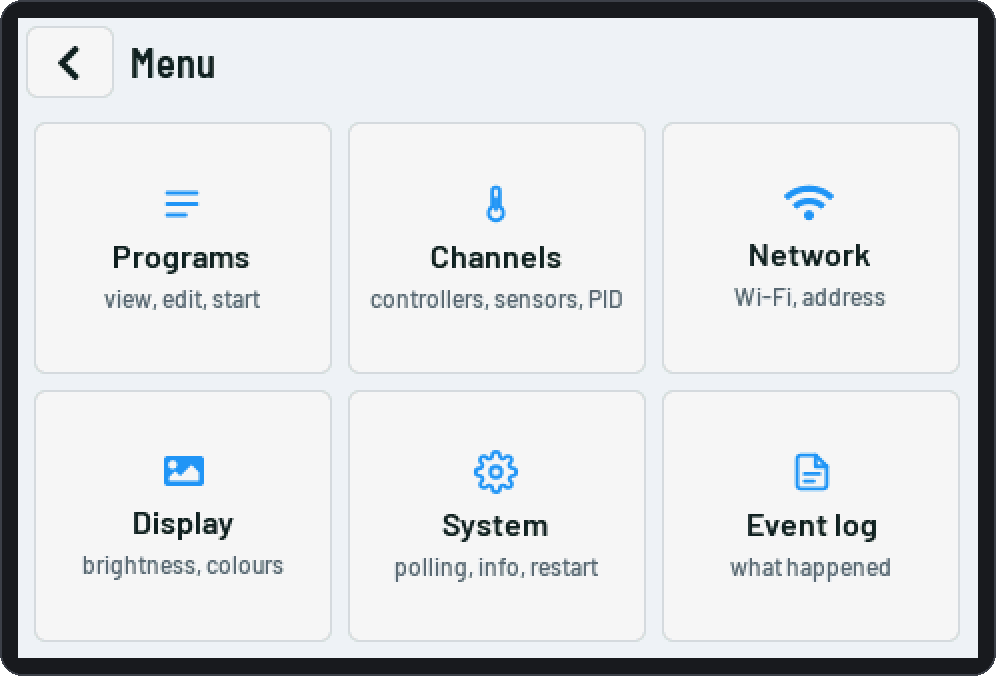</picture>

## Programs

<picture><source media="(prefers-color-scheme: dark)" srcset="img/touch/19-programs-dark.png">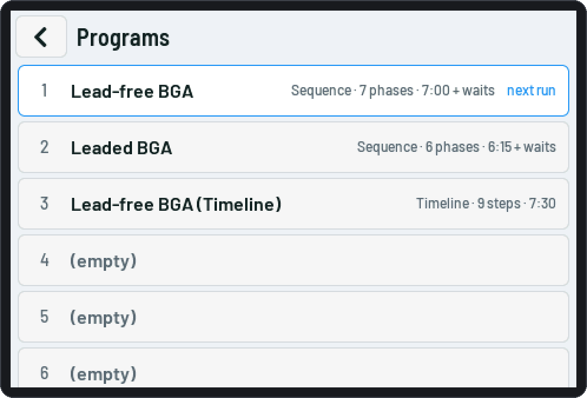</picture>

The 20 program slots. Tap a program to open it in the editor; an empty slot creates a new Sequence or
Timeline.

**Sequence editor** — one table, one row per phase:

<picture><source media="(prefers-color-scheme: dark)" srcset="img/touch/20-edit-seq-dark.png">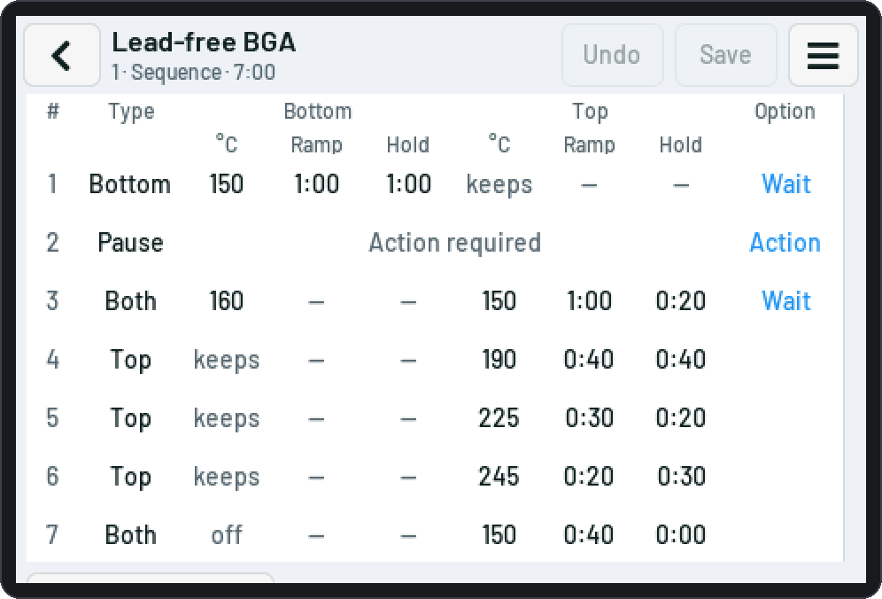</picture>

- Tap a value (target °C, ramp, hold) to change it with the number pad.
- Tap **#** or **Type** for the row menu: phase type (Bottom, Top, Both, Pause), *wait for bottom*, the pause
  text, insert, move, delete.
- The ☰ menu: Undo, Save, Start, Rename, Discard, Delete.

<picture><source media="(prefers-color-scheme: dark)" srcset="img/touch/21-rowmenu-dark.png">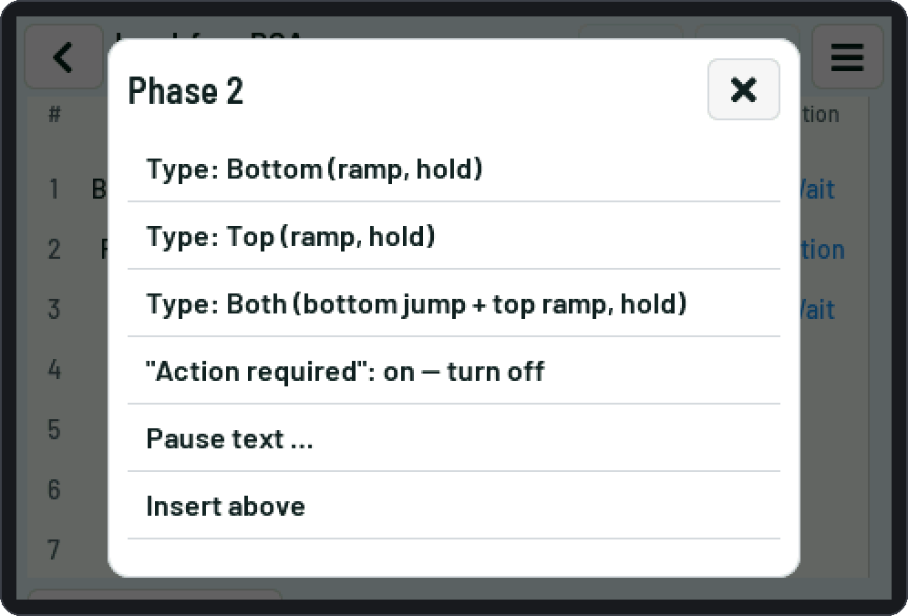</picture>

**Timeline editor** — the two step lists side by side:

<picture><source media="(prefers-color-scheme: dark)" srcset="img/touch/22-edit-tl-dark.png">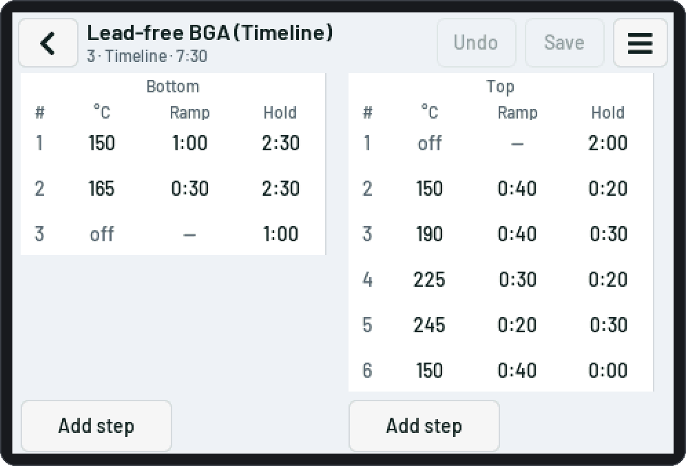</picture>

During a run the editor shows the **running copy**: finished phases are locked, targets and times of the rest
can be changed (run edits).

## Channels

One tab per channel and one for the RS485 bus (beta). *Save* stores the changes, with the same checks as the
web page.

| | |
|---|---|
| <picture><source media="(prefers-color-scheme: dark)" srcset="img/touch/24-chan-local-dark.png">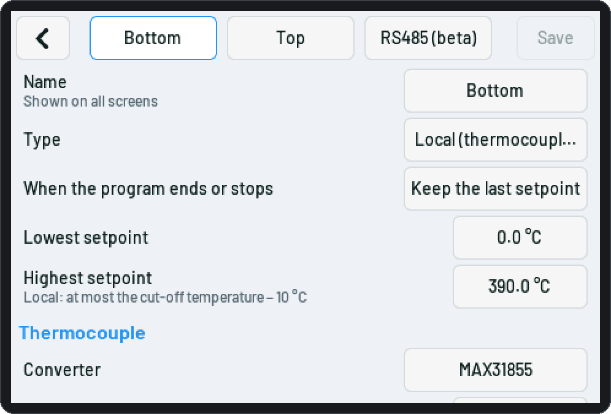</picture> | <picture><source media="(prefers-color-scheme: dark)" srcset="img/touch/27-chan-pid-dark.png"></picture> |
| Name, type, end action, setpoint limits, thermocouple converter, filter | PID values and the **autotune** (test temperature, Start) |
| <picture><source media="(prefers-color-scheme: dark)" srcset="img/touch/28-chan-runaway-dark.png">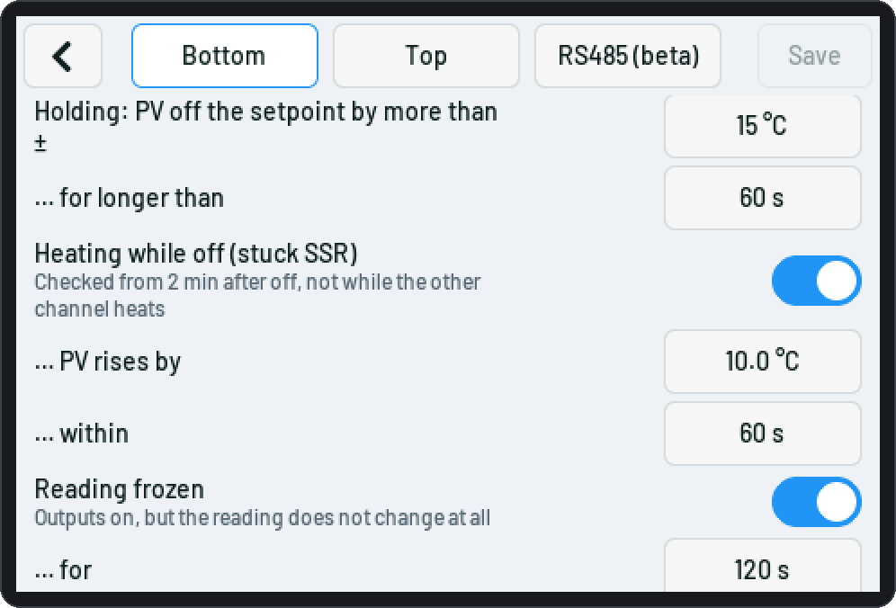</picture> | <picture><source media="(prefers-color-scheme: dark)" srcset="img/touch/25-chan-modbus-dark.png">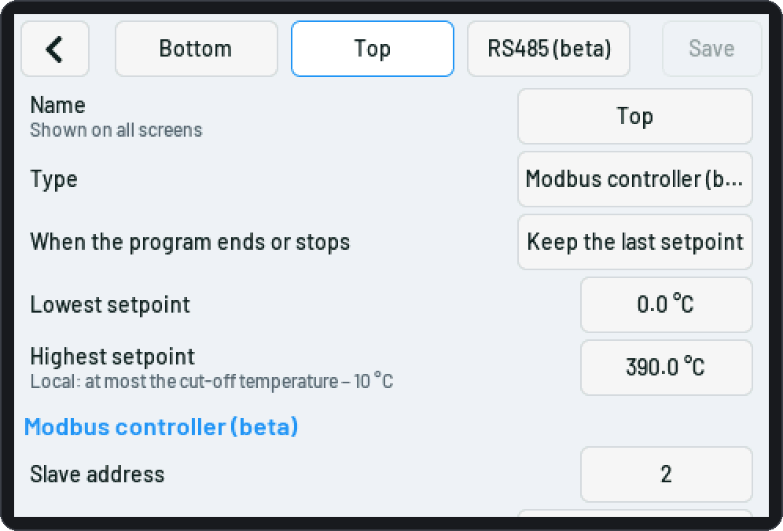</picture> |
| Protection: runaway, heating while off, frozen reading, converter too hot | A Modbus channel (beta): address, controller type, setpoint ramps |

Register addresses and the two-point calibration are on the web page.

## Network

<picture><source media="(prefers-color-scheme: dark)" srcset="img/touch/13-network-dark.png">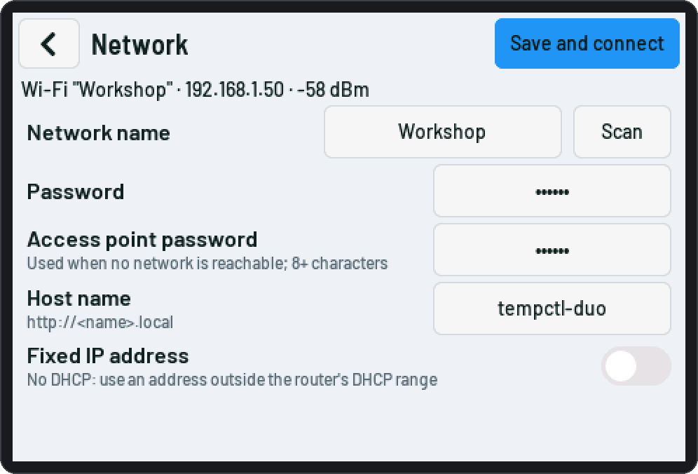</picture>

Network name (tap: scan and pick), password, access point password, host name (`http://<name>.local`), fixed
IP address. The on-screen keyboard:

<picture><source media="(prefers-color-scheme: dark)" srcset="img/touch/16-keyboard-dark.png">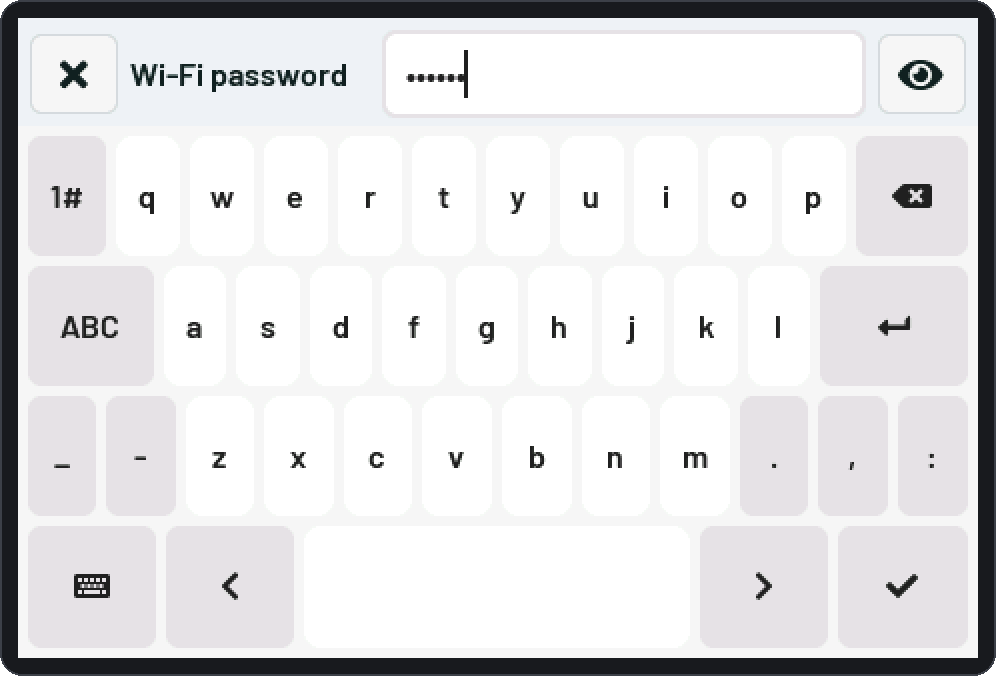</picture>

## Display

<picture><source media="(prefers-color-scheme: dark)" srcset="img/touch/12-display-dark.png">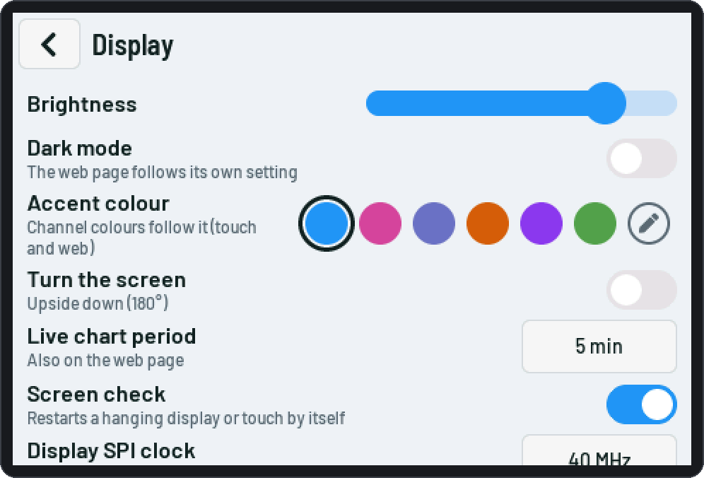</picture>

Brightness, dark mode, **accent colour** (six presets or any colour; the channel colours follow it, on the
web page too), upside down, live chart period, the automatic **screen check**, the **display SPI clock**
(20 / 40 / 80 MHz) and the **frame rate meter** ([Troubleshooting](Troubleshooting.md#display-speed)).

<picture><source media="(prefers-color-scheme: dark)" srcset="img/touch/12b-accent-picker-dark.png">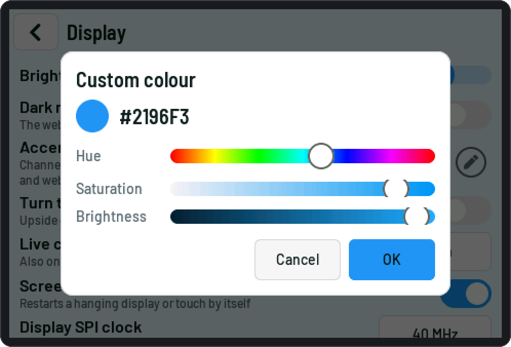</picture>

## System

<picture><source media="(prefers-color-scheme: dark)" srcset="img/touch/14-system-dark.png">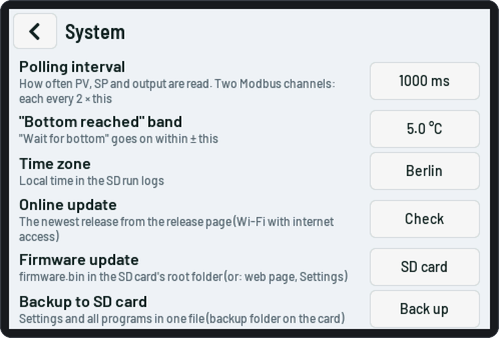</picture>

Polling interval, "bottom reached" band, time zone, then (S3) **Online update**, **Firmware update** from the
SD card, **Backup to SD card** and **Restore from SD card**, then the safety settings (manual mode timeout,
E-stop input, SSR supply relay, alarm sound, chip temperature warning), device info and restart.

| | |
|---|---|
| <picture><source media="(prefers-color-scheme: dark)" srcset="img/touch/14j-online-update-dark.png"></picture> | <picture><source media="(prefers-color-scheme: dark)" srcset="img/touch/14f-restore-list-dark.png"></picture> |
| Online update: a newer release was found | Restore: the backups on the SD card, newest first |
| <picture><source media="(prefers-color-scheme: dark)" srcset="img/touch/14b-tz-regions-dark.png">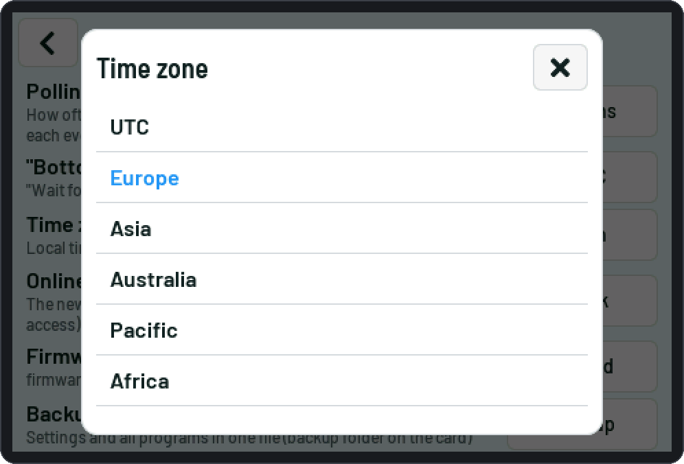</picture> | <picture><source media="(prefers-color-scheme: dark)" srcset="img/touch/14d-system-safety-dark.png">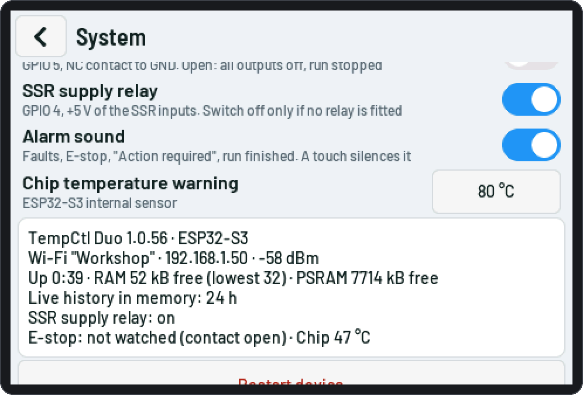</picture> |
| Time zone: region, then place | Safety settings ([Safety](Safety.md)) |

During a firmware update the whole screen shows the progress — don't switch off:

<picture><source media="(prefers-color-scheme: dark)" srcset="img/touch/30-ota-dark.png">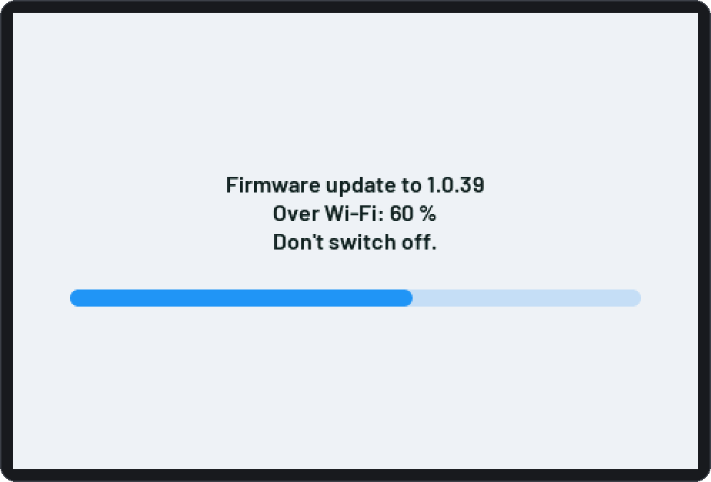</picture>

## Event log

<picture><source media="(prefers-color-scheme: dark)" srcset="img/touch/15-log-dark.png">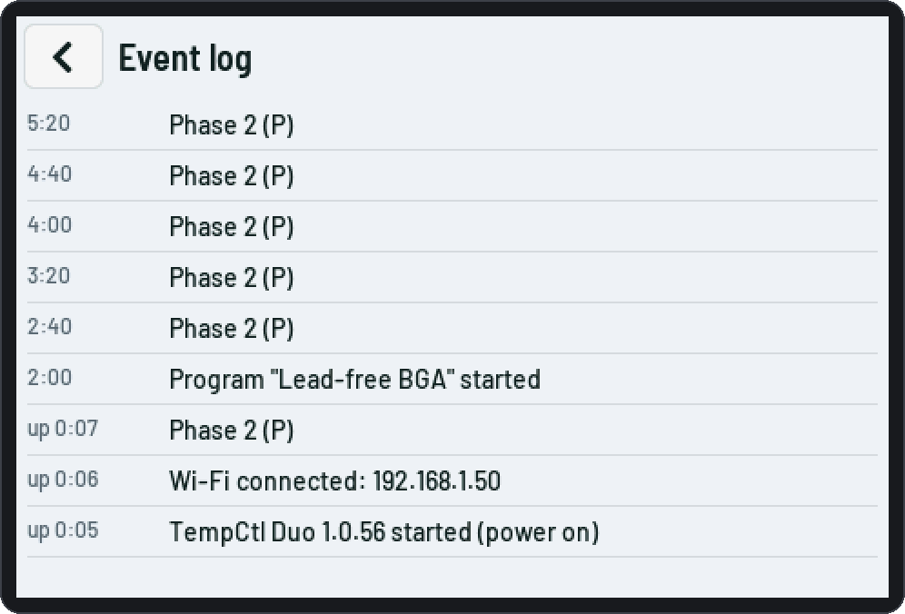</picture>

## CYD (320×240)

The CYD has the same screens as a compact set: the run buttons and the menu move to a bottom bar, each tile has
one SP button (tap: number pad) instead of the stepper, the Sequence editor shows one line per phase (tap: the
phase menu) and the Timeline editor one table with a channel switch above it.

| | |
|---|---|
| <picture><source media="(prefers-color-scheme: dark)" srcset="img/touch/cyd-03-running-dark.png">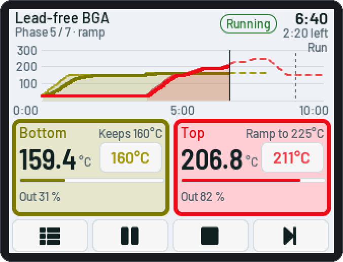</picture> | <picture><source media="(prefers-color-scheme: dark)" srcset="img/touch/cyd-11-menu-dark.png">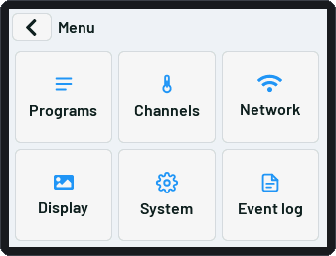</picture> |
| <picture><source media="(prefers-color-scheme: dark)" srcset="img/touch/cyd-20-edit-seq-dark.png">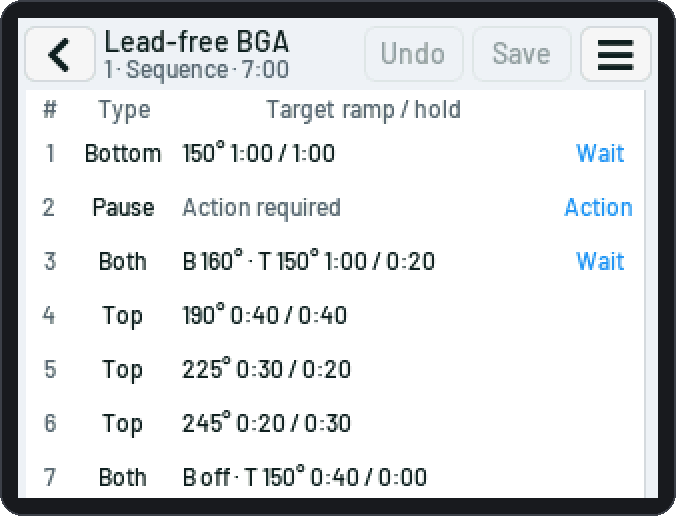</picture> | <picture><source media="(prefers-color-scheme: dark)" srcset="img/touch/cyd-22-edit-tl-dark.png">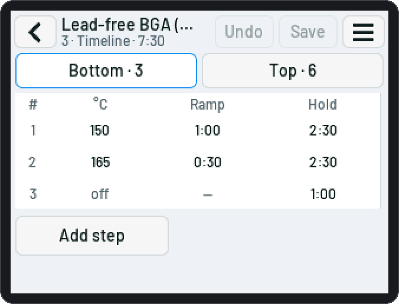</picture> |
| <picture><source media="(prefers-color-scheme: dark)" srcset="img/touch/cyd-24-chan-local-dark.png">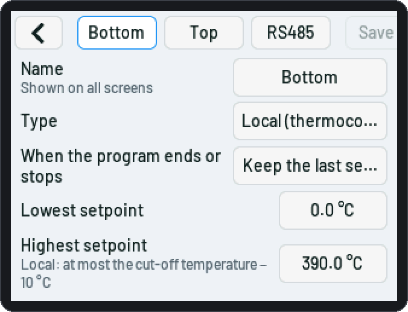</picture> | <picture><source media="(prefers-color-scheme: dark)" srcset="img/touch/cyd-29-touch-cal-dark.png">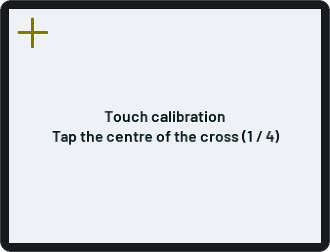</picture> |
