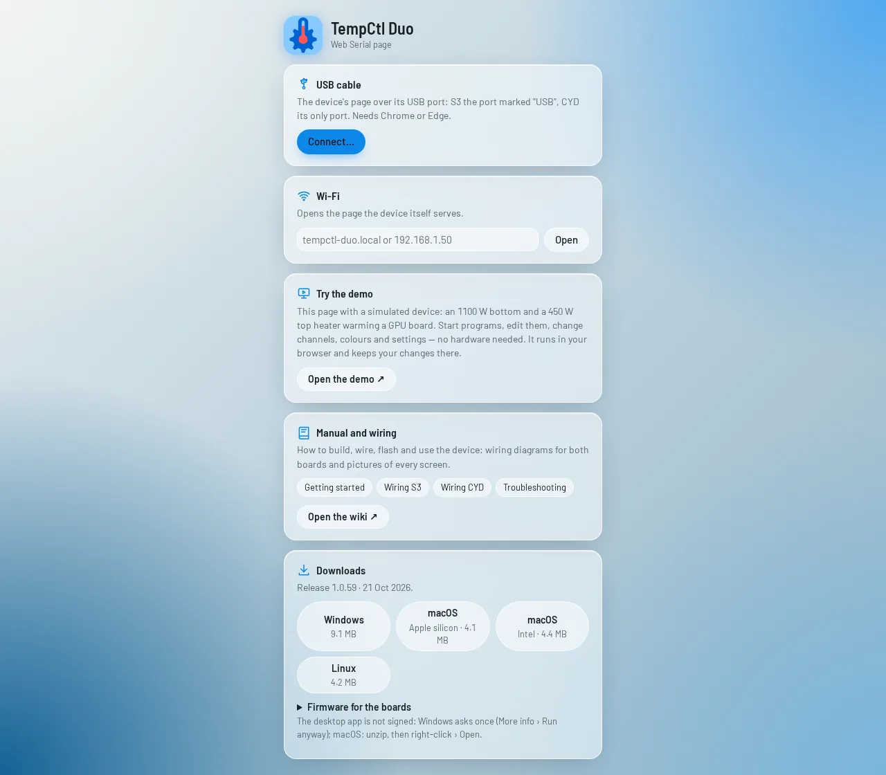
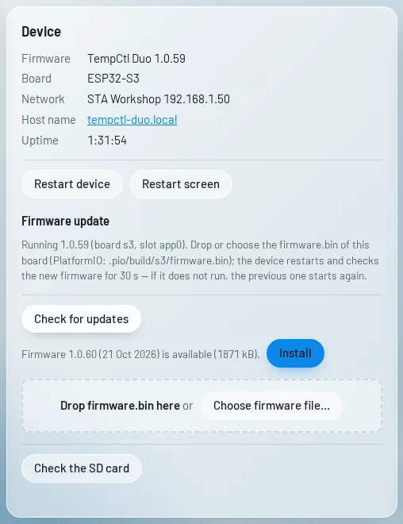
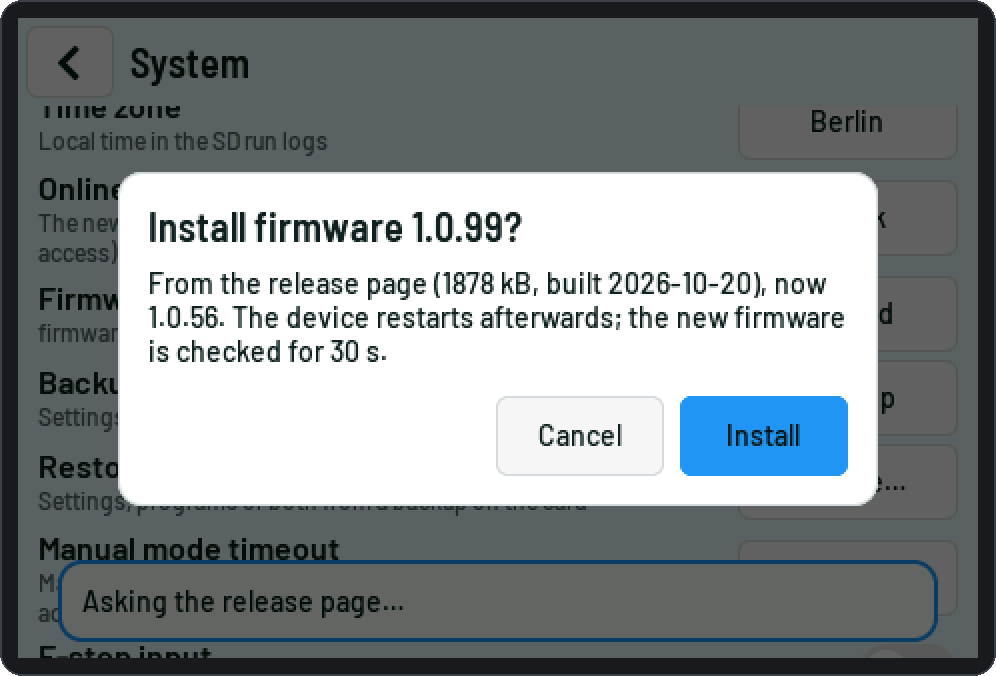
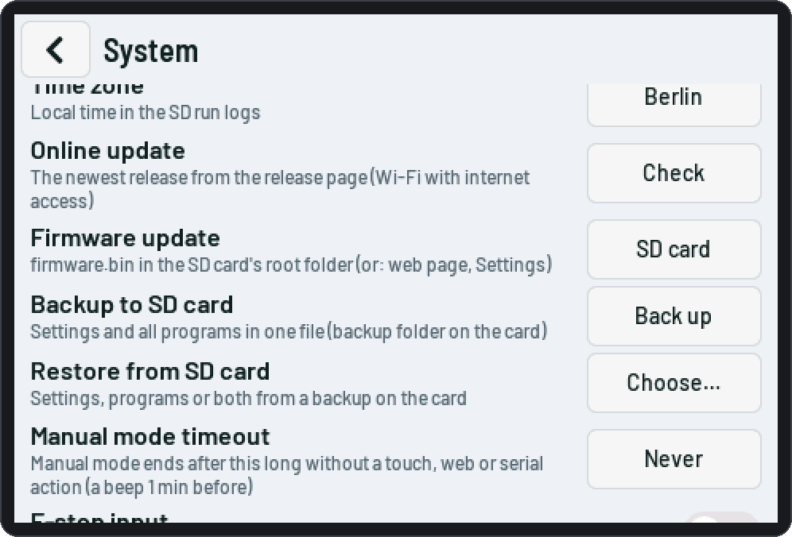
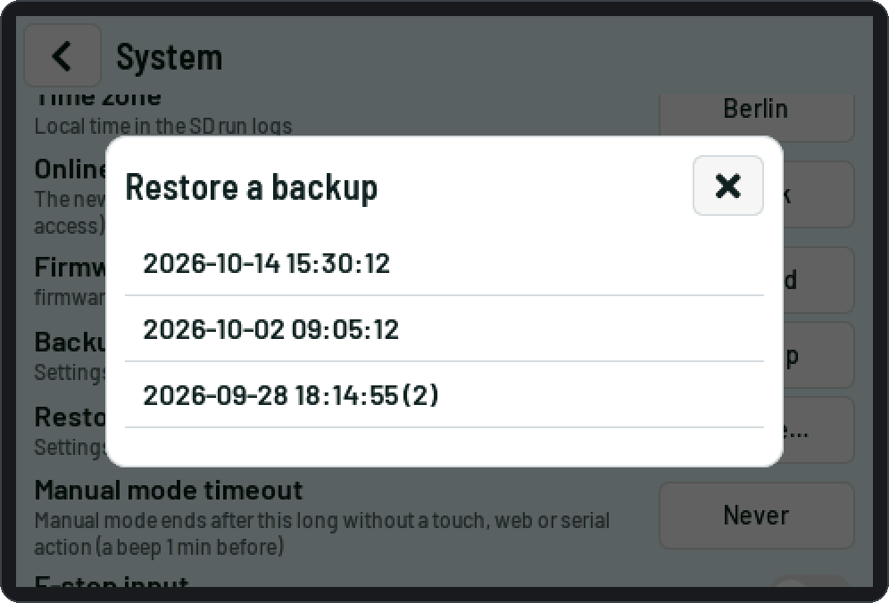

# Updates and backups

## Releases

Every new firmware version is published on the release page **<https://tempctl-duo.just-r0st.workers.dev>**:
the update image and a full image for each board, and the desktop app for Windows, macOS and Linux. Only the
newest release is online.

<picture><source media="(prefers-color-scheme: dark)" srcset="img/web/connect-dark.webp"></picture>

| File | For |
|---|---|
| `tempctl-duo-<version>-<env>.bin` | **update**: over Wi-Fi (web page), from the SD card, or by the S3 itself |
| `tempctl-duo-<version>-<env>-full.bin` | the **first install** over USB: bootloader + partition table + firmware, written at address 0x0 ([Getting started](Getting-started.md#3-flash-the-firmware)) |

`<env>`: `s3`, `cyd-1xlocal-1x485`, `cyd-2xlocal`, `cyd-2xlocal-2x485` — the build that matches your board and
wiring. An image for another board or env is refused (by the page and by the device).

## Updating the firmware

None of the ways below works while a program runs or a channel's output is on. The device restarts with the
new firmware afterwards; settings and programs stay.

### From the release page (all boards)

Web page *Settings › Device › Firmware update* › **Check for updates** (also checked by itself when Settings
opens, at most every 10 minutes). If a newer release exists, **Install**: the browser downloads this board's
image and uploads it to the device, which checks its MD5. Needs a computer or phone with internet access.

<picture><source media="(prefers-color-scheme: dark)" srcset="img/web/settings-update-dark.webp"></picture>

### By the S3 itself

The S3 can fetch the image over HTTPS when its Wi-Fi has internet access: touch *Menu › System › Online
update*, or serial `fw net` then `fw net install yes`. The download runs in the background; the screen shows
the progress.

<picture><source media="(prefers-color-scheme: dark)" srcset="img/touch/14j-online-update-dark.png"></picture>

The CYD leaves this to the web page: an HTTPS session needs about 70 kB of RAM, which the S3 takes from its
PSRAM.

### A file you have

*Settings › Device › Firmware update*: drop the `.bin` file on the box or *Choose firmware file…*, then
*Install*. The page checks the file first (right chip, right board / env); the upload takes about a minute.

### From the SD card (S3)

Copy the update image as **`firmware.bin`** into the card's root folder, then *Settings › Device › Check the SD
card › Install from the SD card*, the touch *Menu › System › Firmware update*, or serial `fw sd` /
`fw sd install yes`. Afterwards the file is renamed `firmware.done`.

### Rollback

The new firmware runs **on probation** and confirms itself after 30 s of normal running. If it crashes or
resets before that, the device starts the previous firmware again and logs "Firmware update to … failed: it
did not start correctly". The event log records every step ("Firmware update started", "… written",
"Firmware updated from … to …", "… confirmed").

## Backups

### Files on the computer (all boards)

*Tools › Backup*: **Download settings** and **Download all programs** as JSON files; *Restore settings…* /
*Restore programs…* load them again. Single programs: *Programs › Export / Import*.

### SD card (S3)

One file per backup with the settings and all programs, in the card's `backup` folder, named by date and time
(`backup/2026-10-14_153012.json`).

- **Back up:** web *Tools › Backup › SD card › Back up to SD card*, touch *Menu › System › Backup to SD card*,
  serial `backup sd`.
- **Restore:** the web page and the touch screen list the backups newest first; pick one, then *settings and
  programs*, *settings only* or *programs only* (with a confirmation). Not while a program runs.
- Settings: all are replaced, but the stored Wi-Fi passwords stay (they are not in the backup); changed network
  settings are used after a restart. Programs: the slots in the backup are replaced, the others stay.
- The web page also downloads and deletes backups; *Restore settings… / programs…* take a backup file too.

| | |
|---|---|
| <picture><source media="(prefers-color-scheme: dark)" srcset="img/touch/14e0-system-backup-dark.png"></picture> | <picture><source media="(prefers-color-scheme: dark)" srcset="img/touch/14f-restore-list-dark.png"></picture> |

## Factory reset

Serial `factory reset yes`: all settings back to their defaults, Wi-Fi included (programs are kept), then a
restart. Not while a program runs.
