# Web page

The device serves its own web page: open **`http://tempctl-duo.local`** (or its IP address) in any browser
on the same network, or `http://192.168.4.1` in access point mode. Everything comes from the device, no
internet needed. The same page works over the USB cable in the [desktop app](Desktop-app.md).

The page follows the browser's light / dark setting until you switch *Dark mode* in the sidebar. Addresses like
`#/programs` or `#/settings` open a page directly (bookmarks).

> **Note:** the page has no login. Keep the device on a trusted network. Requests from other web sites are
> refused (every change needs the header `X-TempCtl: 1`, and the `Host` must be the device).

## Sidebar

<picture><source media="(prefers-color-scheme: dark)" srcset="img/web/sidebar-dark.webp">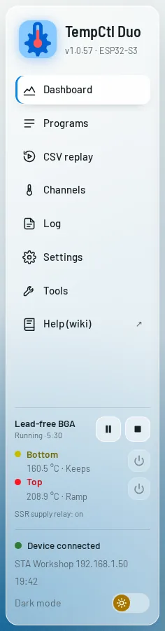</picture>

On every page: the pages, then the run (program, state, time, Start / Pause / Continue / Resume, Stop), both
channels (temperature, what they do, manual on / off), the [monitor channel](Channels.md#monitor-channel-s3)'s
reading while it is on, the SSR supply relay (S3), the connection, address and
clock, and the dark mode switch. On a phone the sidebar becomes a menu and jump buttons appear in the title
bar.

## Dashboard

<picture><source media="(prefers-color-scheme: dark)" srcset="img/web/dashboard-run-dark.webp">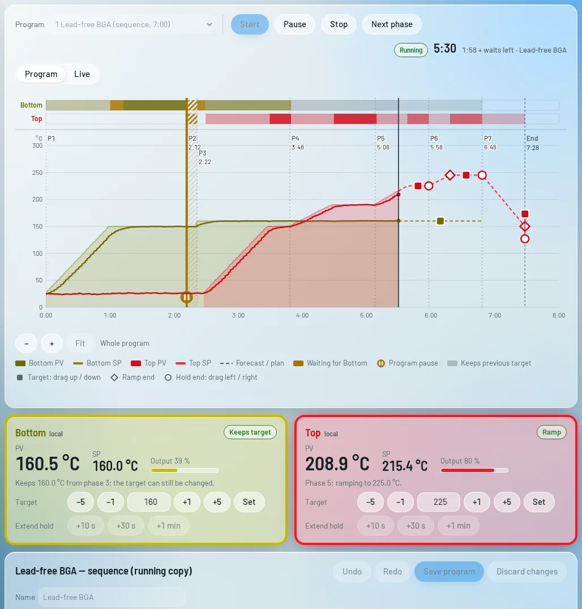</picture>

- **Run panel**: the program, **Start / Pause / Continue / Stop / Next phase**, the state, run time and
  remaining time.
- **Chart** (program view): both channels' temperatures (solid) and setpoints, the **state lanes** above
  (ramp, wait, hold, keeps, pause), phase lines with their times, and the **forecast** of the rest of the run
  (dashed). Zoom with − / + / Fit, Ctrl + wheel, pinch; drag to move. Hover (or touch) shows the values.
- **Channel cards**: PV, SP, output, what the channel does; during a run the target buttons (−5 / −1 / +1 /
  +5 / Set) and *Extend hold*; outside a run the manual switch and setpoint. While the outputs are on the card
  has a border and a tint in the channel colour.
- Below: the **program editor** and the **event log**.

**Live view** — the chart's *Live* tab shows the last minutes or hours (Period: 1 min … 24 h on the S3, 30
min on the CYD). The legend switches each curve on and off; *Export CSV* downloads the whole history.
With the **monitor channel** switched on (S3, [Channels](Channels.md#monitor-channel-s3)) the chart has a third
line in the accent colour, and its legend entry shows the name and the current reading.

<picture><source media="(prefers-color-scheme: dark)" srcset="img/web/dashboard-manual-dark.webp">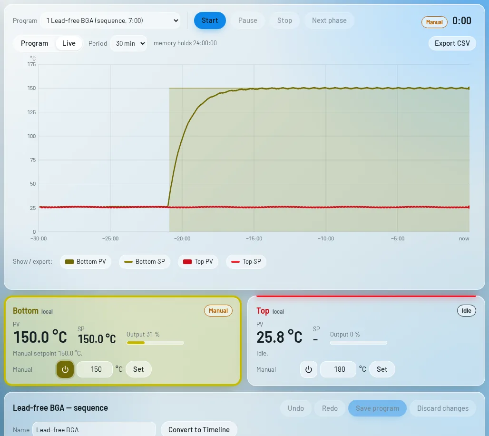</picture>

**Channel cards** during a run and with a fault waiting for *Acknowledge* (blinking badge):

<picture><source media="(prefers-color-scheme: dark)" srcset="img/web/dashboard-cards-dark.webp">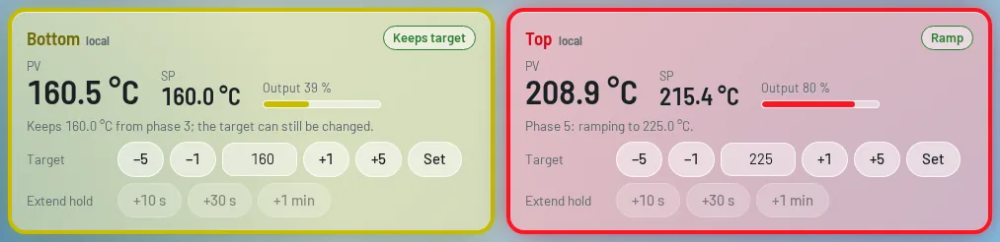</picture>

<picture><source media="(prefers-color-scheme: dark)" srcset="img/web/dashboard-fault-dark.webp">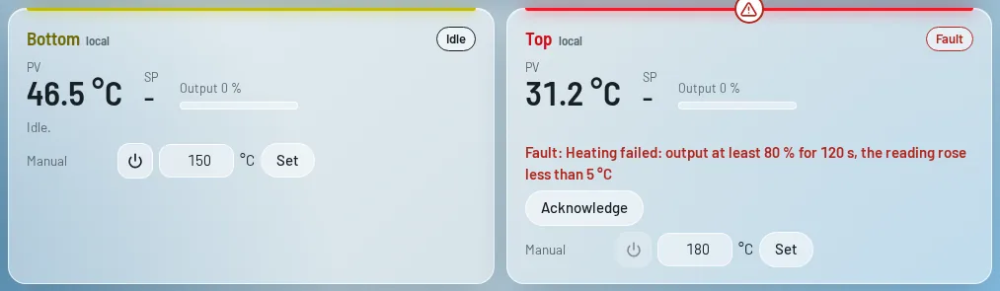</picture>

**Action required** — a Pause phase with a message waits for *Continue program*:

<picture><source media="(prefers-color-scheme: dark)" srcset="img/web/dashboard-action-dark.webp">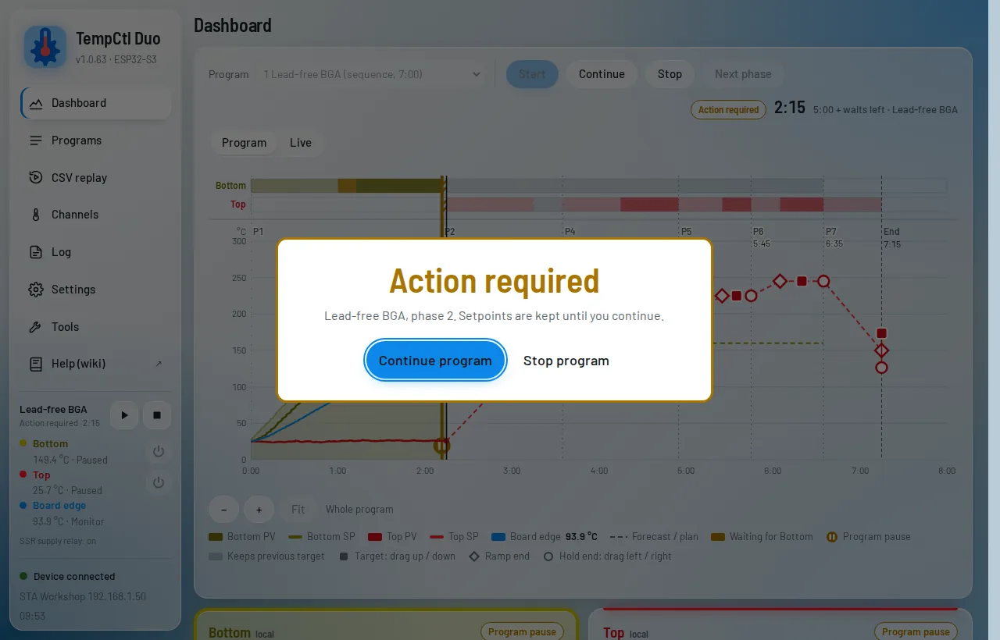</picture>

**After a run** the chart keeps it, with *Export CSV* (PV, setpoint and plan of the run) and *Back to preview*:

<picture><source media="(prefers-color-scheme: dark)" srcset="img/web/dashboard-done-dark.webp">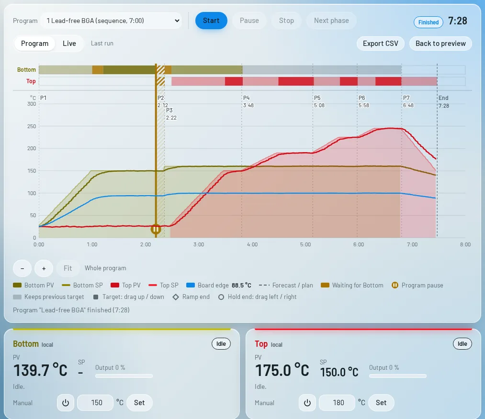</picture>

**Run interrupted by a reset** — *Resume* or *Dismiss* ([Programs](Programs.md#run-interrupted-by-a-reset)):

<picture><source media="(prefers-color-scheme: dark)" srcset="img/web/dashboard-interrupted-dark.webp">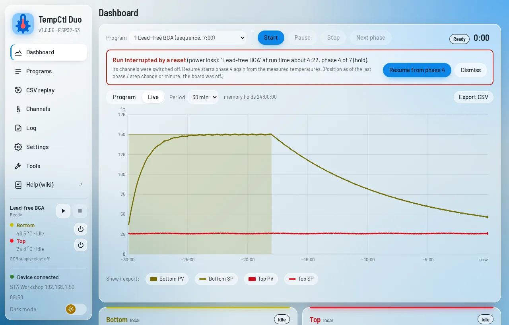</picture>

**Autotune done** — the dialog shows the current and the new PID values: *Accept*, *Edit…*, *Dismiss* or *Later*:

<picture><source media="(prefers-color-scheme: dark)" srcset="img/web/dashboard-autotune-dark.webp"></picture>

### Phone

<picture><source media="(prefers-color-scheme: dark)" srcset="img/web/dashboard-run-phone-dark.webp">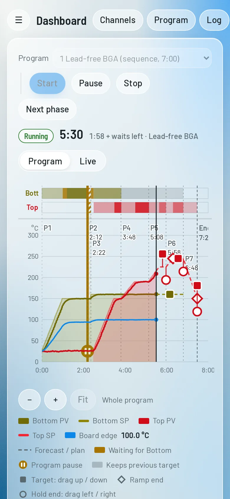</picture>

## Program editor

Under the channel cards: the selected program as tables and as handles on the chart.

<picture><source media="(prefers-color-scheme: dark)" srcset="img/web/editor-seq-dark.webp">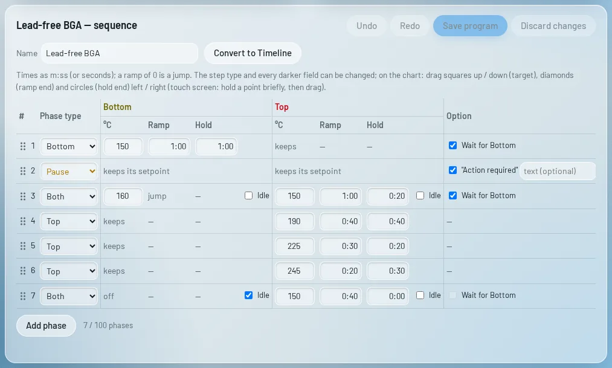</picture>

- **Sequence**: one row per phase (cards on narrow screens). **Timeline**: two tables side by side.
- The **step / phase type** is a dropdown; every value you can change is a darker field (targets in °C, ramp
  and hold as m:ss — plain seconds work too). *Ends* shows when each step or phase finishes (without waits and
  pauses).
- **On the chart**: drag the squares up / down (target), the diamonds (end of a ramp) and the circles (end of
  a hold) left / right; whole seconds and °C.
- Changes go to a **draft** in the browser: *Save*, *Discard changes*, *Undo / Redo* (Ctrl+Z / Ctrl+Y). Drafts
  are lost when the page is reloaded; the program list marks unsaved programs.
- **Convert to Timeline** (Sequence, outside a run): the same temperatures and times as a Timeline, either
  replacing the program (Undo brings the Sequence back until saved) or in a new slot.
- *Start* with unsaved changes asks: Save and start / Start without saving / Cancel.
- During a run the same tables and handles edit the **running copy**; finished phases and the running ramp
  are locked, the changes go to the device at once.

<picture><source media="(prefers-color-scheme: dark)" srcset="img/web/editor-chart-dark.webp">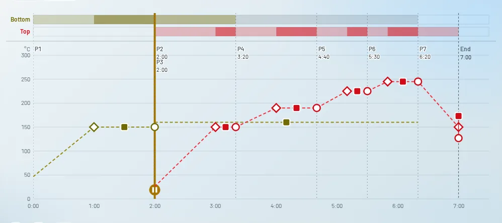</picture>

<picture><source media="(prefers-color-scheme: dark)" srcset="img/web/editor-tl-dark.webp">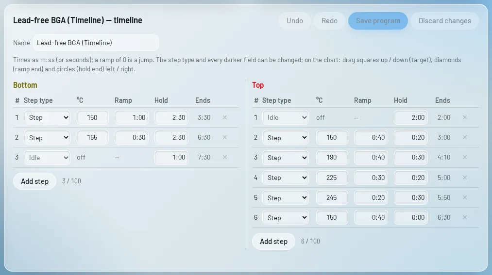</picture>

## Programs

<picture><source media="(prefers-color-scheme: dark)" srcset="img/web/programs-dark.webp">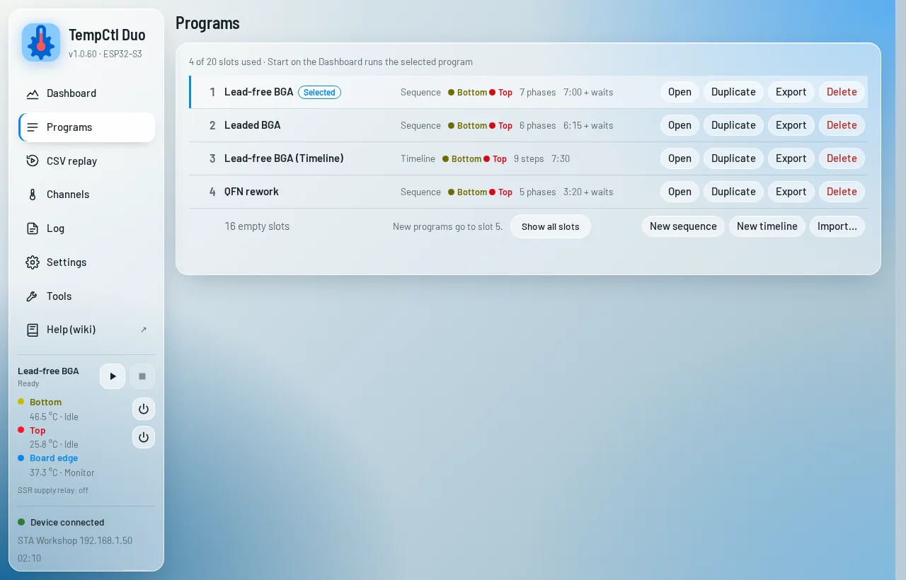</picture>

The 20 slots with type, channels, phases / steps and duration: *Open* (in the Dashboard editor), *Duplicate*,
*Export* (the program as a JSON file), *Delete*; empty slots: *New sequence*, *New timeline*, *Import*.

## Channels

<picture><source media="(prefers-color-scheme: dark)" srcset="img/web/channels-local-dark.webp"></picture>

The *All channels* tile (polling interval, link-loss pause, "bottom reached" band, setpoint margin below the
cut-off), then one tab per channel
(S3: a third tab for the [monitor channel](Channels.md#monitor-channel-s3), in the accent colour).
A channel's tab holds one card per section — *General*, *Thermocouple*, *PID control*, *PID autotune* and
*Protection* (a Modbus channel: *Modbus controller*, *RS485 bus*, *Register addresses*) — with one line per
setting; **ⓘ** shows the explanation. The protection checks read as sentences ("outputs off, but the PV rises by
10 °C within 60 s"). Changed values are marked amber; *Save* sends only them and lists any value the device had
to adjust. *Two-point…* opens the calibration helper.
See [Channels, PID and autotune](Channels.md).

A Modbus channel (beta) has the controller, the RS485 bus, the register map and the controller's parameters
instead:

<picture><source media="(prefers-color-scheme: dark)" srcset="img/web/channels-modbus-dark.webp">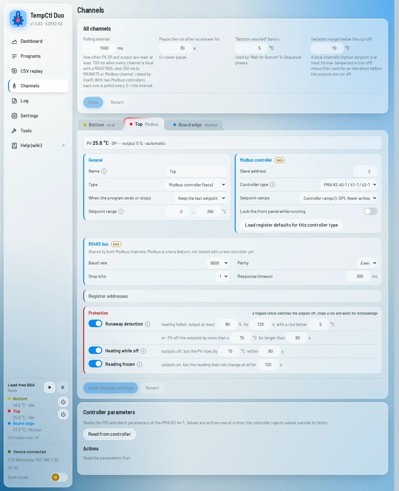</picture>

## Log

<picture><source media="(prefers-color-scheme: dark)" srcset="img/web/log-dark.webp">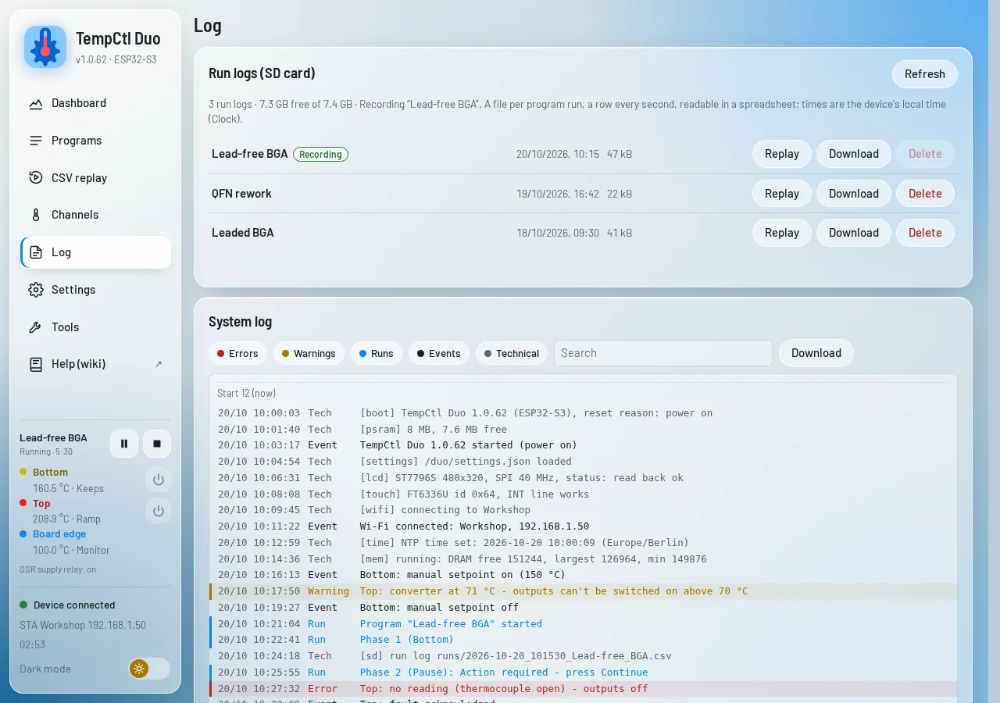</picture>

- **Run logs (SD card, S3)**: one CSV file per program run (a row every second with both channels' PV,
  setpoints, output and state, plus the run's events). *Replay*, *Download*, *Delete*.
- **System log**: everything the device logs, colour-coded (errors, warnings, runs, events, technical lines),
  with filters, search and download. The S3 keeps about 7000 lines, the CYD about 50; the last 300 events
  survive restarts.

## CSV replay

<picture><source media="(prefers-color-scheme: dark)" srcset="img/web/replay-dark.webp">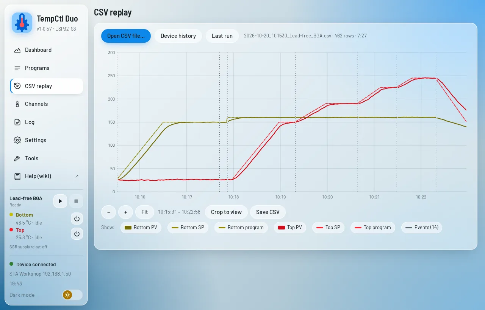</picture>

Any CSV of the device (Export CSV, the live history, an SD run log) as a chart: wheel / two fingers zoom, drag
moves, Shift + drag zooms to a range, double click shows all; *Crop to view* + *Save CSV* write only that part.

## Settings

<picture><source media="(prefers-color-scheme: dark)" srcset="img/web/settings-dark.webp">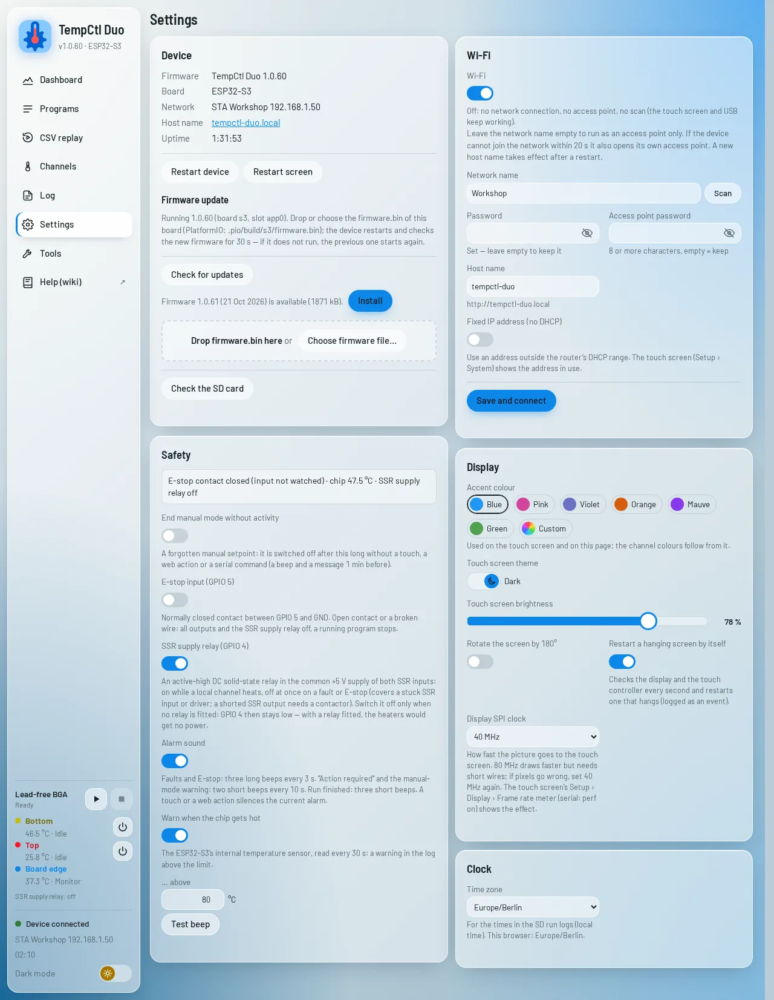</picture>

- **Device**: info, *Restart device*, *Restart screen* (display and touch set up again; the device keeps
  running), **Firmware update** ([Updates](Updates-and-backups.md)).
- **Wi-Fi**: on / off (off: no network, no access point, no scan — the page loses its connection unless it runs
  over USB; switch it on again on the touch screen or with `wifi on`), network (with scan), password, access point
  password, host name, fixed IP.
- **Safety**: manual mode timeout, E-stop, SSR supply relay, alarm sound (with a test beep), chip
  temperature ([Safety](Safety.md)).
- **Display** (applied at once): accent colour, theme, brightness, rotation, screen check, SPI clock.
- **Clock**: the time zone for local times (SD run logs, backups).

<picture><source media="(prefers-color-scheme: dark)" srcset="img/web/settings-update-dark.webp"></picture>

## Tools

<picture><source media="(prefers-color-scheme: dark)" srcset="img/web/tools-dark.webp">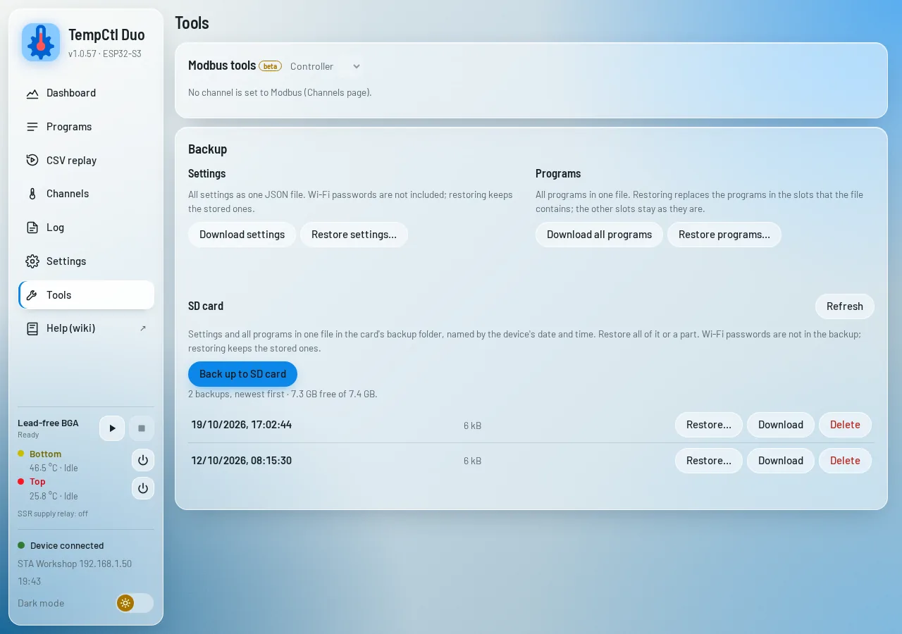</picture>

Modbus tools (for a Modbus channel: find the setpoint address, read registers, write one register), backup and
restore of the settings and of all programs as files, and (S3) the backups on the SD card.
